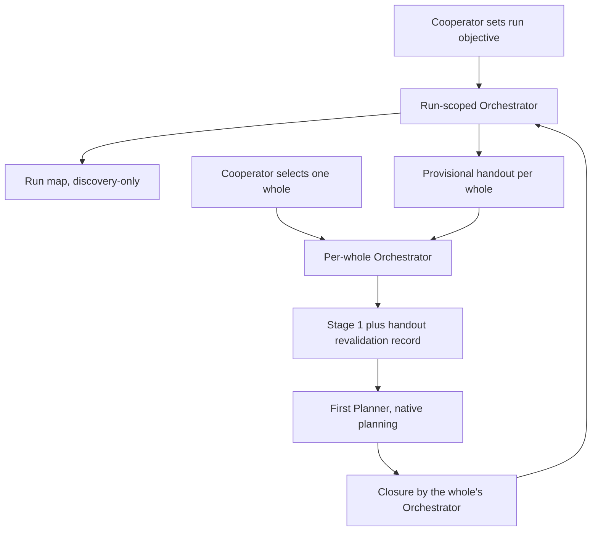

### Report for ORCHESTRATOR_CHAT

```text
Logical whole identity: master-orchestrator-and-report-persistence
Worker session ordinal: 01
Worker exchange ordinal: 01
Persistent role identity: WORKER
Worker session profile: Planner
Worker session target: fresh-worker-session
Native planning mode: required
Planning layer: implementation-planning
Plan disposition: approval-gated
Implementation in same Worker session: prohibited
Delivery route: manual Cooperator delivery
Report author: WORKER
Report persister: WORKER
Report persistence: direct-write /Users/agile/meta/projects/ap/10/00-master-orchestrator-and-report-persistence/01_report_00.md
Repository mutation: none
Host/remote mutation: none
Trace persistence: direct-write /Users/agile/meta/projects/ap/10/00-master-orchestrator-and-report-persistence/01_report_00.md
```

Native planning mode was enabled in the client and was observed blocking file writes during planning (see item 13).

This is a terminal implementation-planning report. It implements nothing. It edits no AP, Kronika or Meta file other than this report, performs no Git write, and changes no pin.

## Compact core

1. **Coordinates.** As echoed above.
2. **Status: PASS.** The plan is decision-complete. The report is persisted through the client completion route described in item 13.
3. **Phase-qualified result:** not-applicable (planning).
4. **Start and end commit.**

```text
AP      start 73e20ef80b88700d5fcbc397cd8edd4fc425869f   end 73e20ef80b88700d5fcbc397cd8edd4fc425869f
Kronika start 7ee4684f529b3d2cdf15ce30902ba01a2b39992c   end 7ee4684f529b3d2cdf15ce30902ba01a2b39992c
Meta    start adb24317b525d3db7659da7d5fa91dd87063a543   end adb24317b525d3db7659da7d5fa91dd87063a543
```

5. **Changed files and purpose.**
   - Only this report changed. AP, Kronika and Meta are otherwise unchanged.
   - The client keeps its native plan artifact in client storage, outside all three repositories.
   - Pre-existing Meta worktree state is owner state and was not touched: the unstaged deletion of `projects/ap/10/master_orchestrator.md` and the untracked directory for this whole.
6. **Tests and validation — exactly what ran.**

```text
AP       git rev-parse/status/log/branch -a/remote -v      -> main at 73e20ef, worktree and index clean
AP       git ls-remote https://github.com/cisarik/ap         -> main 73e20ef; branches 717ecb6, 7ef45da
AP       sh -n ap | ./ap --help | ./ap bundle --help         -> PASS | PASS | PASS
AP       ./ap project check --root /Users/agile/Projects/ap --baseline 73e20ef80b88700d5fcbc397cd8edd4fc425869f
                                                            -> "OK trusted baseline contract", then
                                                               "ERROR: declared CPython executable does not exist" (expected)
AP       git diff --check                                    -> PASS
AP       ./ap doctor                                         -> "this command must run from an initialized .ap submodule" (see item 13)
Kronika  git ls-remote https://github.com/cisarik/kronika refs/heads/main -> 7ee4684 = local HEAD; clean
Kronika  git ls-tree HEAD .ap; git -C .ap rev-parse HEAD     -> 73e20ef for both
Kronika  ./.ap/ap doctor                                     -> PASS (strict pin, clean submodule, managed block, stable)
Kronika  ./.ap/ap project check --root /Users/agile/Projects/kronika --baseline 7ee4684f529b3d2cdf15ce30902ba01a2b39992c -> PASS
Kronika  rg 73e20ef outside .ap; git log -S on the test      -> only tests/contract/test_ap_integration.py:10
Meta     git rev-parse/status; test -e on the report path    -> report absent; parent directory exists
Reading  all named AP files and ADRs; AP_DEFECTS.md in full; AP_DESTILLED.md header, §0, §5.4, §8, §14, §16, §17;
         BRAINSTORMING.md §5 and §7; the pilot handout; the ap/09 trace pattern
```

7. **Commit and push result:** none.
8. **Deviations, risks, missing evidence.**
   - Deviation: an unlisted read-only `./ap doctor` (item 13).
   - Prompt hypotheses corrected: eight items (section A.2).
   - Not observed: the NUC, because there is no authority. These files were not read because they were not named evidence: this whole's `00_RUN_MAP.md`, `00_master_handout.md` and `00_notes.md`, and the Meta README.
   - Only Kronika was checked as a consumer.
   - Risks are in section P.
9. **One smallest next step.** The ORCHESTRATOR verifies this report and obtains Michal's single approval decision: approve with recommendations CD-1 to CD-6, or override named items (section P.3). Then it issues the 02/01 Fresh Implementation Worker prompt (section N).
10. **Report justification:** new-evidence.
11. **Authority expiry.** This planning grant expires with this terminal report. It transfers no implementation, edit, Git, pin, publication, deployment or closure authority.
12. **Compact critique — Orchestration critique.**
   - MEASURED-1. The prompt required native planning mode and a direct-write report, but named no client completion route. In this client, Plan mode blocks every file write until the plan is approved, so the report could be written only after approval. AP §7 already requires "the actual client's permitted completion route". The smallest correction is for the PERSISTENCE comparison to name that route (section J), with an AP_WORKER projection.
   - MEASURED-2. Prompt §7.11 says the Kronika pin update is gitlink-only. That is wrong.
     - `tests/contract/test_ap_integration.py:10` pins `EXPECTED_AP_COMMIT`.
     - The previous pin commit `5843486` left that constant stale; the unrelated commit `ade1169` repaired it.
     - The pin commit must therefore also edit that line, and its focused test must run (section N).
   - MEASURED-3. Prompt §7.11 omits two facts about the pin sequence.
     - `ap update --check` runs a `git fetch` inside `.ap`, so the grant must give that fetch authority.
     - `doctor --candidate` requires `.ap` to be the only dirty path, so the test edit must come after it.
   - MEASURED-4. Two proposed fields would create a second owner or a second spelling.
     - `Report author` is constant: RF-19 assigns authorship to the Worker.
     - `Report persister` duplicates the existing `Report persistence owner` (PROMPT_CONTRACTS.md:819; example at :924).
     - Correction: adopt only the three mutation axes (section I).
   - MEASURED-5. Prompt §7.9 expects §17.6–§17.8 to be added to `AP_DESTILLED.md`. All of §17.1–§17.8 already exist, and §5.4 and §16 already state direct-write. The update is a conversion, not an addition (section G).
   - MEASURED-6. The prompt says "a true restart at 01/01 requires a new logical-whole identity". This conflicts with RF-19, which allows a new identity only for a materially changed objective. Renaming a whole to regain 01/01 is invalid (section J).
   - MEASURED-7. The pilot handout uses non-AP values `Restoration classification: FULL` and `Overall: READY`; AP §14 allows only PASS, PARTIAL or BLOCKED. It also prescribes the non-AP fields `Report author` and `Report persister`. The pilot confirms this (section O).
   - MEASURED-8. AP at 73e20ef names Meta in five places across four files.
     - Those places are `AP.md:465` (RF-19 body), `AP_ORCHESTRATOR.md:476`, `ARTIFACT_LIFECYCLE.md:162` and `:183`, and `PROMPT_CONTRACTS.md:834`.
     - This conflicts with D-21's neutrality.
     - Correction: neutralize the wording (section K).
   - MEASURED-9. Kronika `AGENTS.md` still uses the historical label "Agent Orchestrator" (ADR-0022, replaced by ADR-0023 access profiles). This is consumer lag and is carried forward to Kronika (section F).
   - LEAD-1. The run-scoped Orchestrator is orchestrating this AP whole itself. That departs from the §3 default of a fresh Orchestrator instance per new whole, which must be recorded with its reason. The cheapest check is for the Orchestrator to confirm the record in `00_notes.md`.
   - LEAD-2. This whole's `00_RUN_MAP.md`, the run-scoped Orchestrator's handout `00_master_handout.md` and the Meta README may already diverge from the proposed record shapes. The cheapest check is a comparison during the Meta projection exchange.
13. **Resolved Execution Issues / Near-Misses.**
   - (a) I ran `./ap doctor` in the AP repository. It is not on the prompt's enumerated AP command list.
     - It is non-mutating and stopped at its context check.
     - Its exit status was masked by a pipe, so only the message is reported.
     - State was unchanged.
   - (b) Native Plan mode blocked the direct-write. The full report is kept in the native plan output and written after approval, within this unexpired grant. Nothing is bypassed and nothing is implemented. If the write fails, the terminal notice reports PARTIAL.
   - (c) The sanitized-environment warning also listed the `GIT_CONFIG_COUNT`, `GIT_CONFIG_KEY_0` and `GIT_CONFIG_VALUE_0` classes. These are injected by the client. Only names were seen; no values were inspected.
14. **Pre-Existing Failure Classification.** In the AP repository, `./ap project check` fails with "declared CPython executable does not exist".
   - Classification: pre-existing environment limitation. The declared `.venv/bin/python` is absent, and ADR-0015 rules out a protocol test suite.
   - It was not repaired and it is not a candidate failure.
   - Kronika: none.

---

## A. Verified baseline and revalidation of the prompt

### A.1 Baseline

- **AP repository.** `/Users/agile/Projects/ap`, origin `https://github.com/cisarik/ap`.
  - HEAD is `73e20ef…` on `main`, equal to public `main`; the tree is clean.
  - Highest ADR is 0025, so the next is 0026. Highest pattern is P19, so the next is P20.
- **Kronika repository.** `/Users/agile/Projects/kronika`. HEAD is `7ee4684…`, equal to public `main`; the tree is clean. The `.ap` gitlink and `.ap` HEAD are both `73e20ef…`. `doctor` and `project check` both pass.
- **Meta.** `/Users/agile/meta`, HEAD `adb2431…`, with origin `github.com/cisarik/meta` (public). This report is public-safe: the host-specific interpreter path printed by `project check` is deliberately omitted.

### A.2 Prompt hypotheses: confirmed or corrected

- **Confirmed:**
  - three roles with access profiles (§2, §3);
  - RF-19's split between authorship and persistence;
  - the Planning Budget completion route;
  - §14's rules on handout authorship, predecessors and readiness;
  - Continuation Bootstrap Stages 1 and 2;
  - the RF-09 ledger and its declared discovery;
  - ADR-0023's rejections and deferrals;
  - the UPDATING sequence;
  - the AP validation reality.
- **Corrected:** MEASURED-2 to MEASURED-8 in item 12. Additional partial coverage already exists at 73e20ef:
  - the Source-Read-Only Review Example (PROMPT_CONTRACTS) already models "this exact file write is the sole exception to source-read-only work";
  - §7 issuance readiness already requires every action to fit the grant;
  - Fresh Evidence Probe already distinguishes four mutation domains.

## B. What exists at 73e20ef and what is missing

```text
Concern                         | At 73e20ef                                                        | Genuinely missing
Master Orchestrator             | access profiles (§3); "no fourth role" (§2, RF-06)                | a run-level scope; its limits
Run map                         | nothing                                                           | artifact, status, owner, lifecycle
Provisional handout             | handout authorship/predecessors/supersession/readiness (§14)      | provisional marker; frozen-after-open rule
Per-whole revalidation          | Stage 1 restore-and-verify; handouts subordinate                  | fact-level revalidation record before first Planner
Report persistence              | RF-19 capable Worker may persist; delivery record owner field     | a default; client completion route under native plan
Read-only axes                  | side-effect classes (§5); probe mutation domains                  | general axis declaration; read-only per axis
Satisfiability                  | §7 "every action fits the grant"; one value per record            | four named comparisons; Worker-side stop pointer
Blocked first exchange          | ordinals never reassigned; changed objective -> new identity     | explicit consumption; planning-cycle accounting
Standing AP maintenance         | RF-09 ledger; Stage 1 discovery; out-of-scope -> candidate        | capture-in-every-whole duty; full snapshot on target update
Consumer neutrality             | trace semantics neutral; five Meta mentions remain                | neutral wording at those five mentions
```

## C. Master Orchestrator mapping

**Recommendation (CD-1):** model it as an **Orchestrator session scope**, not an access profile, a mode or a role.

- **Value set:** `Orchestrator session scope: logical-whole | development-run`. The default is `logical-whole`.
- **Name:** "Master Orchestrator" is the explanatory GLOSSARY name for a session with `development-run` scope.
- **Why not an access profile:** an access profile describes what the session can observe (a checkout or mediated access). A run-scoped session may hold either profile, so making it a profile would conflate two axes. ADR-0023 separated access from dispatch for the same reason.
- **Location:** new paragraph `<a id="orchestrator-session-scope">` in AP.md §3, after the Orchestrator/ChatOrchestrator profile paragraphs. Detailed behaviour goes in the new §14 subsection Run-Level Handouts.

**Why the three roles are preserved.**
- The scope is held by an ORCHESTRATOR instance.
- It grants no authority, never selects, plans, accepts or closes a whole, and issues prompts only for a whole it has itself opened after Cooperator selection.
- RF-06 already says that labels and capabilities never create roles; the capsule gains the words "session scopes".

**Answers to BRAINSTORMING §7.10.**
1. It is a session scope (above).
2. The run map is one required artifact while a run scope is active (CD-6). Directory names cannot carry dependencies or status.
3. Rolling horizon: an advisory sentence only, with no number, because ADR-0017 rejects numeric caps.
4. "Provisional → confirmed": the handout header carries `Handout status: provisional` and is frozen once its whole opens. Adoption is recorded in the successor's handout revalidation record, and the run map shows `active`.
5. Only the run-scoped Orchestrator updates the run map and the not-yet-opened handouts. A closing per-whole Orchestrator records its closure. The next whole's Orchestrator revalidates and may write a successor handout.
6. Handouts carry questions, evidence, risks and constraints, never solutions. A provisional handout never satisfies the initial-Planner requirement.
7. The handoff is both a file locator and a Fresh Orchestrator Restoration prompt that cites the handout by its exact path.

## D. Run map, provisional handout, revalidation, lifecycle



**Lifecycle**
- **Run map**
  - Author: the run-scoped Orchestrator.
  - Consumers: the Cooperator, who uses it as a menu, and per-whole Orchestrators, who use it for discovery.
  - Discoverability: the activated trace's local location, named in the run-scoped handout.
  - Retention: kept live through the run, then frozen as historical evidence.
  - Cleanup trigger: the Cooperator ends the run.
  - Supersession: by the next run's map.
  - Authority: discovery only.
- **Provisional handout**
  - Author: the run-scoped Orchestrator.
  - Consumer: the per-whole Orchestrator.
  - Refreshable until the whole opens, then frozen.
  - Superseded only by an explicit successor handout.
- **Handout revalidation record**
  - Written by the per-whole Orchestrator during Stage 1.
  - Stored in the per-whole notes when the trace is active; otherwise in the first Cooperator-facing restoration message.
- **Run closure:** every entry is `closed`, `dropped` or `superseded`, or the Cooperator ends the run. The run map is frozen with a one-line closure statement.

## E. File-by-file change map

### E.1 AP.md (sole semantic owner)

- **Per-Role Minimum-Reading Spine.** In the ORCHESTRATOR row's Reference-on-demand column, add "[Run-Level Handouts](#run-level-handouts) when the session scope is `development-run` or a provisional handout is received".
- **RF-06 capsule.** Change to "Orchestrator access-profile labels, session scopes, and dispatch capabilities are distinct".
- **RF-09 capsule.** Append one pointer to `#standing-ledger-maintenance`.
- **§2 last paragraph.** Change to "Orchestrator access profiles Orchestrator and ChatOrchestrator, and Orchestrator session scopes, are defined in §3, not additional persistent roles."
- **§3, new paragraph `orchestrator-session-scope`.** Draft:

> An Orchestrator session also has one **session scope**, independent of its access profile. `logical-whole`, the default, coordinates one selected logical whole. `development-run` prepares one Cooperator-bounded development run — an ordered set of candidate logical wholes — through the run map and provisional handouts of [Run-Level Handouts](#run-level-handouts); *Master Orchestrator* is its explanatory name. Like an access profile, a scope is a routing label: it is not a role, grants no authority, and never selects, plans, accepts, or closes a logical whole. A run-scoped session issues Worker prompts only for a whole it has opened as that whole's Orchestrator after Cooperator selection, recording that departure from the fresh-instance default; it never prompts, reconciles, accepts, or closes for a whole coordinated by another Orchestrator instance. An initialization signal or handout opening a run-scoped session declares `Orchestrator session scope: development-run` and the development run identity. Detection: **artifact-detectable**, on initialization signals, run maps, and issued prompts.

- **§5, after "Tasks classify consequential side effects…": new paragraph `mutation-axes`.** Draft:

> Every newly issued Worker grant declares three **mutation axes** — repository mutation, host/remote mutation, and trace persistence — each `none` or one exact bounded scope. Repository mutation covers the task's source repositories; host/remote mutation covers machines, services, accounts, and external systems outside them; trace persistence covers file writes into an activated trace. *Read-only* qualifies an axis, never a whole grant. A Worker's own exact terminal report, and an authorized Planner's exact received prompt, is trace persistence under RF-19, not repository or host mutation, and still needs exact positive path authority. Git operations remain under Git authority. Axes make scope checkable; they replace no positive or negative authority or side-effect class, and a probe contract may refine them into finer domains. Detection: **artifact-detectable**, on the three axis fields and their agreement with positive authority and persistence owners.

- **§7, after "Readiness includes the actual client's permitted completion route…": new paragraph `prompt-satisfiability-check`.** The text is in section J.
- **RF-19 coordinates, after "…require stop and prospective correction.": new paragraph `consumed-coordinates`.** The text is in section J.
- **RF-19 persistence.**
  - Replace "the Cooperator owns Meta Git actions" with "the Cooperator owns trace Git actions".
  - After "Other authorized capable Workers may persist their own reports directly." insert:

> When an activated delivery record names a report destination and the assigned Worker's client permits that exact write, the default persistence owner is that Worker (`Report persistence owner: assigned WORKER`) with matching `Trace persistence`. Another persister is used only by explicit Cooperator selection or a recorded missing Worker capability; the Worker then returns the complete report in the session and writes no trace file. When native planning controls block writes until plan approval, the Planner keeps the complete report in the client's plan output and writes it once the client permits, within the same unexpired grant and without implementing; otherwise the [completion route](#planning-budget-and-expiry) applies.

- **Planning Budget and Expiry.** Append the blocked-planning sentence from section J.
- **§13.**
  - In the per-whole notes sentence, add "and the handout revalidation record when a provisional handout was received".
  - Upgrade Observation Ledger: append the paragraph `standing-ledger-maintenance` from section K.
- **§14.**
  - New subsection `### Run-Level Handouts`, placed before Continuation Bootstrap, with an explicit anchor. Draft:

> A run-scoped Orchestrator maintains one **run map** per development run: the Cooperator-selected run objective and exclusions, the ordered candidate logical wholes, dependencies, each entry's run status, the locator of each provisional handout, and one sentence of evidence per entry. The run map is discovery and decision support, not a roadmap, selection, plan, or authority; project roadmaps and accepted decisions keep their owners, and the Cooperator may reorder, add, or drop entries at any time. Only the run-scoped Orchestrator changes run status, from the whole's own selection, revalidation, and closure evidence; closure remains that whole's Orchestrator decision under RF-02.
>
> A **provisional handout** is a restoration handout written for a logical whole before that whole's Orchestrator opens it. It carries `Handout status: provisional`, the restoration content and readiness review above, and the questions, evidence, risks, and constraints its first Planner must address — not that Planner's answers. It never satisfies the initial-Planner requirement, fixes a design, selects a whole, or grants authority. Its author may refresh it until the whole opens; afterward it is frozen evidence. Write provisional handouts only as far ahead as revalidating them stays cheaper than rewriting them.
>
> When the whole opens, its Orchestrator performs Continuation Bootstrap Stage 1 and revalidates every material handout fact against current evidence before the first Planner prompt, recording a handout revalidation record. A successor never edits a provisional handout in place; a material rewrite is a successor handout under the predecessor and supersession rules above. Detection: **artifact-detectable**, on the run map, handout marker, revalidation record, and the first Planner prompt's continuity anchor.

  - Continuation Bootstrap Stage 1: add "A provisional handout additionally requires the handout revalidation record of [Run-Level Handouts](#run-level-handouts) before the first Planner prompt."
  - Continuation Bootstrap Stage 2: add "A run map's order is a recommendation, never a selection."
- **§18.** Extend the stop list with "mutation axes or persistence fields contradict each other".
- **§19.** Add four anti-patterns:
  - treating *read-only* as a label for the whole grant, or as forbidding a granted trace report write;
  - routing a capable Worker's report through the Cooperator by default;
  - treating a run map or provisional handout as selection, plan or authority;
  - reusing consumed coordinates, or renaming a whole to restart at `01/01`.

### E.2 Operational projections

**AP_ORCHESTRATOR.md**
- Continuation Bootstrap: Stage 1 gains the provisional-handout revalidation step; Stage 2 gains "run map ≠ selection".
- New section `## Run-Scoped Orchestration`, after Rotation and Restoration, as an operational checklist:
  - obtain the run objective and exclusions;
  - keep one run map;
  - write provisional handouts on an advisory rolling horizon;
  - hand off by locator plus a restoration prompt;
  - prefer a fresh per-whole Orchestrator, and record the departure if the run-scoped session opens a whole itself;
  - after each closure, update the status and refresh, supersede or obsolete the remaining handouts;
  - capture friction under the standing duty;
  - keep optional run notes;
  - close the run;
  - stop if a prompt targets another Orchestrator's whole, if acceptance or closure is attempted for it, or if the run map is stale.
- Decision Table: one row for run-level handoff.
- Worker Exchange Coordinates: one bullet on consumed coordinates.
- Prompt Construction: step 4 points to the satisfiability check; step 5 adds "declare the three mutation axes".
- Per-Whole Orchestrator Notes: "Meta README" becomes "the activated trace's own documentation", and the revalidation record is added.
- Artifact and Ledger Governance: one pointer to the standing duty.

**AP_WORKER.md**
- Reporting gains:

> "Output is your report" describes content; `Report persistence owner` and `Trace persistence` decide delivery. When they name you, write exactly that report file (and an authorized Planner's exact prompt), read it back, write nothing else, then send the terminal notice. When native planning controls block writes, keep the complete report in the plan output and write it once the client permits, within the same grant; never bypass the control.

- Worker Exchange Coordinates and Trace Boundary: check that the axes agree before writing; contradictory axes are a stop under §18.

**PROMPT_CONTRACTS.md**
- Common Worker Task Fields → Authority: three rows, plus a `#### Mutation Axes Record` (section I).
- Cooperator Delivery and Trace Destination Record: one sentence pointing to the RF-19 default, plus consistency rules P1–P5 (section I).
- Source-Read-Only Review Example: add the three axis lines after `Archival: wait-for-report`.
- Worker Exchange Identity: add a Blocked First Exchange Example (section J).
- Trace-Local Filename Mapping: add a `02/01 -> 02_planning_00.md` line.
- Planning Record: add the corrected-initial shape (section J).
- Fresh Orchestrator Restoration: add `Orchestrator session scope` and `Development run identity`.
- New `#### Run Map Record`, `#### Provisional Handout Marker` and `#### Handout Revalidation Record`.
- AP Integration Task: add "AP Update Task" bullets:
  - an activation snapshot of all active declared-ledger entries, each given a disposition;
  - fresh independent acceptance;
  - publication as a separate step;
  - one separate pin grant per consumer;
  - consumer files that pin the AP commit updated atomically with the gitlink.
- Line 834: "Example using Meta-local storage" becomes "Example using an activated trace's local storage grammar".

**ARTIFACT_LIFECYCLE.md**
- New `## Run Maps and Provisional Handouts` section, using section D's lifecycle.
- Two rows in the distribution table.
- Neutral wording at lines 162 and 183.

**INTEGRATION.md**
- Optional Consumer Upgrade Ledger: one pointer sentence to the standing duty.
- Trace Grammar paragraph: a trace grammar may name run-map and handout filenames, and delivery declarations default to direct-write.

**UPDATING.md**
- Review checklist gains one item: review the mutation axes, the direct-write default, provisional handouts and consumed coordinates against the new pin, and update consumer-owned conventions and any consumer file that pins the AP commit in the same pin change.

### E.3 Explanatory and historical files

- **GLOSSARY.md:** rows for Orchestrator session scope, Development run, Run-scoped Orchestrator ("Master Orchestrator"), Run map, Provisional handout, Handout revalidation record, Mutation axes, Trace persistence, Direct-write report persistence, Prompt satisfiability check and Consumed coordinates. Each row has one line and a link.
- **FAQ.md:**
  - update "Can a Planner or Worker save its own report?" to cover the default and per-axis read-only;
  - new "What is a run-scoped (Master) Orchestrator?";
  - new "What happens to coordinates after a blocked exchange?";
  - in "Who can author a handout…?", add a pointer to provisional handouts.
- **README.md:** one Reading Order row for run-level preparation, pointing to AP §14 Run-Level Handouts and AP_ORCHESTRATOR Run-Scoped Orchestration.
- **INTUITION.md:** in §2, "…session profiles, session scopes, phases, and dispatch arrangements never add a fourth role".
- **CHANGELOG.md, docs/adr/README.md and the new docs/adr/0026-run-scoped-orchestration-mutation-axes-and-direct-write-reports.md:** see section H.

### E.4 Files not changed

- **AP:**
  - `ap` and `ap.project.conf` — the managed block and schema v1 stay byte-identical, so consumer `doctor` stays compatible;
  - `PROMPT_ENGINEERING_PATTERNS.md` (section L);
  - `INFOSEC.md`;
  - `.gitignore`;
  - the bodies of ADRs 0004–0025.
- **Kronika:** all files except `.ap` and `tests/contract/test_ap_integration.py:10`. In particular:
  - `AGENTS.md`, including its project-owned label lag;
  - `docs/AP_UPGRADE_OBSERVATIONS.md`, where reconciling the stale `accepted/not-started` entry is carried forward;
  - all product code and docs.
- **Meta:** only `AP_DESTILLED.md`, `AP_DEFECTS.md` (append-only) and one status line in `BRAINSTORMING.md` §7 change, plus the Meta README if it owns the local grammar (LEAD-2), in the Meta projection exchange.

## F. AP_DEFECTS disposition (every open entry)

Each entry below uses the prompt's columns. The owner, the AP owner or reason, and the evidence are at 73e20ef unless stated otherwise.

- **D-01 — already-implemented.**
  - Owner: AP.
  - AP owner: §17 compact core item 12.
  - Evidence: the MEASURED/LEAD critique (ADR-0023).
  - Proposed change: none.
- **D-02 — carry-forward.**
  - Owner: a future AP whole selected by the Cooperator.
  - Reason: out of scope; partial coverage exists.
  - Evidence: the "summarize; full output only on failure" rule. ADR-0023 rejected a word cap.
  - Proposed change: none now.
- **D-03 — already-implemented.**
  - Owner: AP.
  - AP owner: §12, "do not repeat a broad check without relevant candidate/environment change".
  - Evidence: the applicability rule in §12 (ADR-0017, ADR-0023).
  - Proposed change: none.
- **D-03b — carry-forward (consumer-owned).**
  - Owner: the consumer's project rules.
  - Reason: the scope of a project rule belongs to the project.
  - Evidence: §12, "determine project-gate applicability".
  - Proposed change: none in AP.
- **D-04 — carry-forward.**
  - Owner: a future AP whole.
  - Reason: the coverage rule exists; the field has only one witness so far.
  - Evidence: §14, "a search pattern alone proves no universal absence".
  - Proposed change: none now.
- **D-05 — superseded.**
  - Owner: AP.
  - AP owner: RF-02's direct-versus-Worker boundary; §3 access profiles.
  - Evidence: the ADR-0020 and ADR-0023 profiles.
  - Proposed change: none. Kronika's label lag goes to MEASURED-9.
- **D-06 — already-implemented.**
  - Owner: AP.
  - AP owner: §3 dispatch default for a full Orchestrator, with the independence disqualifier kept.
  - Evidence: ADR-0025.
  - Proposed change: none.
- **D-07 — already-implemented.**
  - Owner: AP.
  - AP owner: the Per-Role Minimum-Reading Spine; P19.
  - Evidence: Semantic Authority, "a conflict stops".
  - Proposed change: none.
- **D-08 — reject.**
  - Owner: AP.
  - Reason: ADR-0023 rejected the rename, and the closure precedence already exists.
  - Evidence: Orchestration Planning, "execution … takes precedence over more analysis".
  - Proposed change: none.
- **D-09 — reject.**
  - Owner: AP.
  - Reason: ADR-0023 rejected a mandatory overhead record.
  - Evidence: ADR-0023, rejected list.
  - Proposed change: none.
- **D-10 — already-implemented.**
  - Owner: AP.
  - AP owner: RF-05 (fresh but non-independent); the Fresh Evidence Probe and Diagnostic profiles.
  - Evidence: ADR-0023, "self-review remains useful".
  - Proposed change: none.
- **D-11 — carry-forward (deferred).**
  - Owner: ADR-0023's deferral.
  - Reason: concurrency needs re-gating, and the satisfiability check reduces the need.
  - Evidence: ADR-0023, "use a complete compact renewed grant".
  - Proposed change: none.
- **D-12 — carry-forward.**
  - Owner: a future AP whole, together with D-02.
  - Reason: same family as D-02.
  - Evidence: the tier owners in RF-07.
  - Proposed change: none now.
- **D-13 — accept (partially implemented).**
  - Owner: this whole.
  - AP owner: §14 readiness, plus the new revalidation record.
  - Evidence: §14, "copied inventories identify their coverage".
  - Proposed change: Handout Revalidation Record, "Not revalidated" row.
- **D-14 — already-implemented.**
  - Owner: AP.
  - AP owner: §3 Communication Routing ("A" / Continue).
  - Evidence: ADR-0023 item 13.
  - Proposed change: none.
- **D-15 — already-implemented (semantics).**
  - Owner: AP; file naming belongs to the trace documentation.
  - AP owner: §14 predecessors and supersession, "newer time never supersedes".
  - Evidence: ADR-0023.
  - Proposed change: the run-level successor rule (section E.1).
- **D-16 — reject.**
  - Owner: AP.
  - Reason: ADR-0023 rejected a numeric tier-spread split.
  - Evidence: ADR-0023, rejected list.
  - Proposed change: none.
- **D-17 — accept.**
  - Owner: this whole.
  - AP owner: the RF-19 default.
  - Evidence: RF-19 allows capable persistence but sets no default.
  - Proposed change: the direct-write default (section E.1).
- **D-17b — accept.**
  - Owner: this whole.
  - AP owner: RF-19 plus §5.
  - Evidence: the same as D-17.
  - Proposed change: the default plus the mutation axes.
- **D-18 — already-implemented.**
  - Owner: AP.
  - AP owner: the §5 data-decision check; "development status authorizes no deletion".
  - Evidence: ADR-0023.
  - Proposed change: none; the default it proposed is rejected.
- **D-19 — accept.**
  - Owner: this whole.
  - AP owner: the four comparisons in §7.
  - Evidence: §7, "every action fits the grant" (partial).
  - Proposed change: section J.
- **D-20 — accept.**
  - Owner: this whole.
  - AP owner: §5 mutation axes.
  - Evidence: the side-effect classes and probe domains (partial).
  - Proposed change: sections E.1 and I.
- **D-21 — accept (consumer-neutral form).**
  - Owner: this whole.
  - AP owner: the standing paragraph in §13 RF-09.
  - Evidence: the RF-09 ledger and Stage 1 discovery (partial).
  - Proposed change: section K.

AP_DEFECTS remains evidence, not task authority. Durable record: this table is appended to `AP_DEFECTS.md` as `## 7. Disposition record — AP <published SHA> (ADR-0026)`. The historical defect bodies are not changed.

## G. AP_DESTILLED update plan (Meta explanatory projection; not authority)

- **Header box:** add "AP <published SHA> adopted D-17/D-17b, D-19, D-20, D-21 and run-scoped orchestration (ADR-0026)".
- **§0:** keep the historical note for pin 9c5cc44. Add §0.1 "Measured after the pin": AP <published SHA>, listing the changed AP anchors from section E.1.
- **§5.4:** turn the direct-write sentence into a pointer to the RF-19 default.
- **§8:** add mutation axes and pointers to the satisfiability check.
- **§14:**
  - add item 23, "read-only without axes / courier report";
  - add item 24, "a pre-written handout trusted without revalidation";
  - both as pointers.
- **§16:** document `00_RUN_MAP.md` and the provisional `00_handout.md` as local names that the trace documentation owns.
- **§17:**
  - retitle as "adopted into AP <published SHA>";
  - turn §17.1–§17.8 into pointers that keep their measurement text;
  - in §17.3, record that `Report author` and `Report persister` were not adopted (the existing owner field plus the axes are used instead) and that `in-session-only` corresponds to relay;
  - in §17.8, keep the Meta-local instruction and point to the AP §13 duty.
- **New §18:** a one-page summary of the run-scoped Orchestrator, as pointers.

## H. ADR-0026 and CHANGELOG

**ADR-0026: Run-Scoped Orchestration, Mutation Axes, and Direct-Write Report Persistence.** Status: Accepted. Sections:
- **Context:** measured consumer evidence of the courier trap, read-only prompts that forbade their own report, and first exchanges blocked by prompt defects; the run-level proposal; partial coverage at 73e20ef.
- **Decision:** the eight decisions in sections C–K, including neutral trace wording.
- **Semantic ownership and projections.**
- **Alternatives rejected:**
  - a fourth role;
  - an access-profile value;
  - "Master" as the structural value;
  - the `Report author` and `Report persister` fields;
  - in-place confirmation of handouts;
  - ledger storage outside the consumer repository, which would revisit ADR-0016;
  - a numeric horizon;
  - P20;
  - a satisfiability attestation field or a checker.
- **Partial supersession:** ADR-0023's neutral persistence (no default) and the "bounded snapshot" scope in ADR-0016. Their bodies stay unchanged.
- **Compatibility:**
  - prospective only; historical prompts keep their meaning under their own pin;
  - no change to `ap`, the managed block, schema v1 or the project contract;
  - consumers adopt by updating their pin.
- **Consequences, validation, rollback.**

Index: one row plus one paragraph in `docs/adr/README.md`, in the style of ADR-0025.

**CHANGELOG (Unreleased, inserted at the top):**

> Added run-scoped orchestration and direct-write report persistence under ADR-0026: an Orchestrator session scope (`logical-whole | development-run`, explanatorily the Master Orchestrator) that adds no role or authority; run maps, provisional handouts and per-whole handout revalidation; three mutation axes with read-only scoped per axis; a direct-write default for a capable Worker's own trace report; a four-comparison prompt satisfiability check; consumed coordinates after a blocked exchange; and a consumer-neutral standing upgrade-ledger maintenance duty. The executable, managed block, schema v1 and historical ADR bodies are unchanged. Independent candidate acceptance, publication, consumer adoption and closure remain separate evidence.

## I. Structural fields and exact spellings (owner: PROMPT_CONTRACTS, under AP.md)

```text
Repository mutation: none | <exact repository paths>
Host/remote mutation: none | <exact targets and operations>
Trace persistence: none | direct-write <exact trace paths>

Orchestrator session scope: logical-whole | development-run
Development run identity: <stable project-local identifier> | not-applicable
Handout status: provisional

Run map: <development run identity>
Run objective: <Cooperator-selected objective and exclusions>
Run map authority: discovery-only
Run entry: <order> | <logical-whole identity> | <run entry status> | depends on: <identities | none> | handout: <locator | not-written> | evidence: <one sentence>
Run entry status: provisional | handed-off | active | closed | superseded | dropped

Handout revalidation: <handout locator>
Received handout status: provisional
Revalidated against: <repository commit; AP pin; other durable anchors>
Usable facts: <list> | none
Stale facts and corrections: <fact: handout value -> measured value> | none
Not revalidated: <fact and reason> | none
Handout disposition: adopted | adopted-with-corrections | superseded-by <successor locator>
```

**Report author, persister and persistence.**
- Author: always the assigned Worker (RF-19). This is not a field.
- Persister: the existing field `Report persistence owner: assigned WORKER | ORCHESTRATOR | COOPERATOR | <named capable actor>`.
- Persistence mode: derived, not a separate field.

**Consistency rules.**
- **P1.** If the owner is `assigned WORKER`, then `Trace persistence` names exactly the report destination (plus the prompt path for an authorized Planner), and positive authority grants that write.
- **P2.** If the owner is anyone else, then `Trace persistence: none`, the prompt states the relay basis (a Cooperator selection or a missing capability), and the report is returned in the session.
- **P3.** If `Trace persistence` is not `none`, the delivery record is `configured`.
- **P4.** If native planning is required and the Worker writes directly, the client completion route is named.
- **P5.** `Repository mutation: none` never forbids granted trace persistence.

An issued record holds one value per line. The `Handout status` field is absent from ordinary handouts, and a missing scope field in a historical handout means `logical-whole`.

## J. Satisfiability check and blocked first exchange

**Draft for AP.md §7 (`prompt-satisfiability-check`):**

> Before delivery, the Orchestrator applies four comparisons to the complete prompt. **Validation–authority**: every required command, observation, generated output, and completion write fits the positive authority, and no negative clause forbids it. **Routing**: every identity, coordinate, route, mode, and destination field holds exactly one concrete value. **Persistence**: persistence owners, the three mutation axes, positive authority, and the client's permitted completion route agree. **Spelling**: every path, tool, environment variable, field, and command comes from its current durable owner, not memory or an earlier handout. A failed comparison is an issuance defect corrected before delivery. A Worker that finds one stops under §18 and reports it as MEASURED orchestration critique. The check is a review, not a register or attestation field. Detection: **artifact-detectable**, on the issued prompt.

**Draft for RF-19 (`consumed-coordinates`):**

> Coordinates are consumed once their prompt is issued to a concrete session, whatever the outcome; a blocked, cancelled, superseded, interrupted, or later withdrawn exchange keeps them. The next exchange follows the ordinary transitions: the next exchange ordinal for a healthy current-session renewal, or the next session ordinal for a fresh session. When a whole's first exchange stops on a prompt defect and a fresh session is selected, the corrected initial Planner is `02/01`. Reusing consumed coordinates, or changing the logical-whole identity to regain `01/01` for the same objective, is invalid. A trace records a consumed exchange through its ordinary prompt and outcome pair; removing a pair from a live trace tree requires preserved provenance and frees no coordinate.

**Draft for Planning Budget:**

> A planning exchange that stops on a prompt defect before any plan exists consumes its coordinates but not the initial planning cycle; the corrected prompt keeps `Planning cycle: initial` and names the blocked report as `Prior planning report`.

**PROMPT_CONTRACTS example.**
- Standard projection: `01_planning.md` and `01_report.md` (BLOCKED) are followed by `02_planning.md` and `02_report.md`.
- Meta-local mapping: `01_planning_00.md` and `01_report_00.md` are followed by `02_planning_00.md` and `02_report_00.md`.
- The corrected prompt's capsule tells the Cooperator why the session ordinal is `02`.

## K. Standing AP maintenance (consumer-neutral)

**Draft for AP.md §13 (`standing-ledger-maintenance`):**

> Maintaining the protocol and tools a project depends on is ordinary work. When project rules declare an upgrade ledger, every Orchestrator revalidates it during Continuation Stage 1. During any logical whole it records newly measured friction against the ledger's target as `untriaged` entries through an exact write grant to the declared storage, or, without such a grant, as non-authorizing ledger candidates in its closure or handoff record. A logical whole that changes the ledger's target includes every active entry of the declared ledgers available to it in its activation snapshot and records a disposition for each before closure. Capture and triage authorize no implementation. Declared storage stays in the consuming repository; no trace, archive, or other location becomes a discovery source. A consumer may keep other protocol-friction evidence; a task may cite it explicitly, and it never becomes AP authority. Detection: **artifact-detectable**, on ledger entries, closure records, and the activation snapshot.

**Neutralization.** Five places use neutral wording ("trace Git actions"; "the activated trace's own documentation"; "an activated trace's local storage grammar"): `AP.md:465`, `AP_ORCHESTRATOR.md:476`, `ARTIFACT_LIFECYCLE.md:162` and `:183`, and `PROMPT_CONTRACTS.md:834`.

**Options for D-21 (CD-2).**
- **K1 (recommended).** Add the duty above, keep RF-09 same-repository storage, and keep `AP_DEFECTS.md` as Cooperator-owned cross-project evidence that tasks cite explicitly.
  - Cost: observations live in two places.
  - Benefit: no Meta dependency and no reversal of ADR-0016.
- **K2.** Allow external declared ledger paths.
  - Cost: reverses ADR-0016, needs redesign for path escape and public safety, and carries high review risk.
- **K3.** No AP change.
  - Cost: the duty stays unenforced, and D-17b shows the friction recurs.

## L. Pattern decision

**No P20.**
- The existing "Closure and handoff" and "Restoration after compaction" rows already cover the generation of run-level handouts: P01, P02 (handoff budget, "grants no new authority") and P06 (reconstructable state).
- P18's evolution rule requires recurring evidence or one high-severity failure; so far there is only the pre-pilot proposal.
- `PROMPT_ENGINEERING_PATTERNS.md` is unchanged. Revisit after the pilot.

## M. Validation and independent acceptance

### M.1 Candidate checks

The implementation Worker runs these, then the acceptance Worker runs them independently.

```text
V1  git rev-parse HEAD; git log -1 --format=%P            -> one commit whose parent is 73e20ef          [identity]
V2  git diff --name-status 73e20ef..<candidate>            -> exactly the 13 M + 1 A paths of section E   [scope]
V3  git diff --check 73e20ef..<candidate>                   -> clean                                       [hygiene]
V4  git diff --quiet 73e20ef..<candidate> -- ap ap.project.conf INFOSEC.md PROMPT_ENGINEERING_PATTERNS.md .gitignore
                                                           -> exit 0                                      [executable/block/schema unchanged]
V5  git diff --name-only 73e20ef..<candidate> -- docs/adr  -> only 0026 and README.md                    [historical bytes]
V6  sh -n ap; ./ap --help; ./ap bundle --help              -> exit 0                                      [executable smoke]
V7  rg -o link targets in changed files; test -e each relative file; every #anchor matches an
    explicit <a id> or a heading slug; new AP.md subsections carry explicit anchors              [cross-references]
V8  rg -n '^#{2,4} ' per changed file; sort | uniq -d on slugs -> no duplicates; tree matches E    [headings]
V9  rg -n -F each section I spelling -> defined once in PROMPT_CONTRACTS, verbatim elsewhere;
    rg -n -i 'report persister|report author:' -> only in the ADR-0026 alternatives;
    rg -n -w Meta --glob '!docs/adr/**' --glob '!CHANGELOG.md' -> no match                       [spelling, neutrality]
V10 diff review: every new normative sentence is in AP.md and states Detection; each projection is a
    pointer plus at most one orientation sentence                                                  [single owner]
V11 scenario walk-through S1-S14 against the candidate text                                       [behavioural adequacy]
V12 ./ap project check --root /Users/agile/Projects/ap --baseline 73e20ef80b88700d5fcbc397cd8edd4fc425869f
                                                           -> expected ERROR, recorded, not repaired      [limitation]
```

**Limitation.** V7 approximates GitHub slugs with `rg`, `sed` and `tr`. Headings that contain punctuation are checked by hand. No Python is used.

### M.2 Scenarios

Each scenario states the expected outcome.
- **S1.** Read-only audit that writes its own report directly: lawful.
- **S2.** "Write no file" combined with `assigned WORKER`: a PERSISTENCE defect.
- **S3.** Required validation forbidden by negative authority: a VALIDATION–AUTHORITY defect.
- **S4.** A `<select:…>` value in an issued prompt: a ROUTING defect.
- **S5.** A misspelled tool path: a SPELLING defect.
- **S6.** Blocked 01/01: the corrected Planner is 02/01, `Planning cycle: initial`, with the blocked report named.
- **S7.** Renaming to regain 01/01: invalid.
- **S8.** A run-scoped session prompts another Orchestrator's whole: invalid.
- **S9.** First Planner issued without a revalidation record: invalid.
- **S10.** A run map order treated as a selection: invalid.
- **S11.** A Planner whose client blocks writes until approval writes afterwards within the same grant: lawful.
- **S12.** Relay selected by the Cooperator: lawful.
- **S13.** An AP update with a declared ledger and no Meta path: lawful.
- **S14.** A "Master" label claims authority to accept: invalid.

### M.3 Independent acceptance

**Who and what.**
- A Fresh Independent Audit in session 03/01: a fresh session with no inherited transcript, read-only, with a direct-write report.
- Package:
  - the exact candidate SHA and its base 73e20ef;
  - this approved report, as the source of acceptance criteria;
  - `02_report_00.md`, as claims to verify;
  - Michal's decisions, verbatim.
- It runs V1–V12 and S1–S14 and reads the full diff.

**Result:** `Acceptance PASS`, `correction-required` or `BLOCKED`.

**Why independence is required.** RF-05 and RF-07 require independence for changes to the sole protocol. RF-02 forbids direct acceptance by the Orchestrator. The implementer's self-review is evidence only.

**Budget:** one primary acceptance, plus at most one correction (02/02 Bounded Correction Worker, then 04/01 Fresh Independent Re-Audit). A third cycle needs a Cooperator decision.

### M.4 Consumer compatibility checks (section N, pin exchange)

- Before and after: `doctor` and `project check`.
- `doctor --candidate`.
- `git diff --submodule`.
- Focused contract tests through `./.ap/ap exec`.
- Public-ref readback.

### M.5 Remains unverified

Recorded in the closure.
- Practical effect across future wholes (the pilot is partial).
- Consumers other than Kronika.
- The NUC: unchanged and not observed.
- The real dispatch route.

## N. Exchanges, grants, publication, pin, rollback

**Clean path.**

```text
02/01 Fresh Implementation Worker   02_implementation_00.md / 02_report_00.md   High, about 300k
03/01 Fresh Independent Audit       03_acceptance_00.md     / 03_report_00.md   High, about 250k
02/02 publication (renewal)         02_publication_01.md    / 02_report_01.md   Medium
04/01 Kronika pin update            04_pin-update_00.md     / 04_report_00.md   Medium
04/02 Meta projections (renewal)    04_meta-projection_01.md/ 04_report_01.md   Medium
05/01 Fresh Evidence Probe (pilot)  05_pilot-probe_00.md    / 05_report_00.md   Medium
```

**Correction path.** After 03/01: 02/02 correction, then 04/01 re-audit, then 02/03 publication. The pin moves to 05 and the pilot to 06. If session 02 is no longer healthy, publication uses the next fresh session.

**Every grant carries:**
- `Native planning mode: not-used`;
- `Delivery route: manual Cooperator delivery`;
- `Report persistence owner: assigned WORKER`;
- `Host/remote mutation: none`;
- `Trace persistence: direct-write /Users/agile/meta/projects/ap/10/00-master-orchestrator-and-report-persistence/<NN>_report_<XX>.md`.

**02/01 implementation**
- Repository mutation: exactly the 14 AP paths in section E.
- Git: `git add` of those paths and one local commit on `main`. No push, fetch, amend, reset, branch or tag.
- Stop if AP HEAD or public main is not 73e20ef, or if ADR 0026 exists.
- Validation: V1–V12.
- Suggested commit message: `docs: add run-scoped orchestration and direct-write report persistence (ADR-0026)`.

**02/02 publication**
- Repository mutation: none.
- Git:
  - `git ls-remote origin refs/heads/main` must equal 73e20ef;
  - then `git push origin <accepted SHA>:refs/heads/main`, non-force;
  - then read back with `ls-remote`.
- Stop if the remote moved.

**04/01 pin update (CD-3: the Worker commits and pushes)**
- Repository mutation: in `/Users/agile/Projects/kronika`, exactly `.ap` and `tests/contract/test_ap_integration.py:10`.
- Git: a fetch inside `.ap` only (through `ap update --check`), add, one commit, non-force push. Order:

```text
git status --porcelain=v1 (empty); git ls-remote origin refs/heads/main == HEAD; ./.ap/ap doctor
./.ap/ap update --check            (available == accepted AP SHA, else stop)
./.ap/ap update --apply
./.ap/ap doctor --candidate        (before any other edit)
git diff --submodule               (only .ap 73e20ef..<new>)
edit tests/contract/test_ap_integration.py:10 to the new SHA
git add .ap tests/contract/test_ap_integration.py
./.ap/ap doctor
./.ap/ap project check --root /Users/agile/Projects/kronika --baseline <Kronika HEAD>
./.ap/ap exec --root /Users/agile/Projects/kronika --baseline <Kronika HEAD> --operation test-focus -- tests/contract/test_ap_integration.py tests/contract/test_worker_execution_contract.py -q -p no:cacheprovider
git diff --cached --name-only      (exactly the two paths)
git commit -m "docs: update analytic programming"; git push origin HEAD:refs/heads/main; git ls-remote origin refs/heads/main
```

- No NUC refresh: the NUC stays at 7ee4684 until the next routine product refresh.

**04/02 Meta projections**
- Edit `AP_DESTILLED.md` (section G).
- Append to `AP_DEFECTS.md` (section F).
- Add one status line to `BRAINSTORMING.md` §7.
- Update the Meta README only if it owns the local grammar.
- No Git: Michal commits.

**Rollback.**
- **AP before publication:** do not push. A destructive local reset of `main` to 73e20ef needs its own grant, after the candidate SHA is preserved in the report.
- **AP after publication:** `git revert <SHA>` as a new commit (never a force push) under a new grant. Verify that `git diff 73e20ef <revert>` is empty.
- **Kronika:** `git revert <pin commit>`, then `git -C .ap checkout --detach 73e20ef80b88700d5fcbc397cd8edd4fc425869f`, `doctor --candidate`, `doctor`, the focused test, and a push, all under a separate grant. The rollback point is 7ee4684 with `.ap` at 73e20ef.

## O. Pilot dry-run (CD-4: Fresh Evidence Probe)

**Set-up.**
- WORKER, Fresh Evidence Probe, phase Restoration support, `fresh-worker-session`, session 05/01 on the clean path.
- Prompt: `05_pilot-probe_00.md` in this whole's directory.
- Report: `05_report_00.md` in the same directory.
- Input: `/Users/agile/meta/projects/kronika/01/01-timeline-and-history-media-thumbnails/00_handout.md`.

**Task.** Run the per-whole Stage 1 from AP_ORCHESTRATOR at the new Kronika pin, read-only.
- Fill a Handout Revalidation Record for every handout fact.
- Expected stale facts: §1.1 HEAD, §1.2 pin, §4.1 fields, §7 `READY`, and the missing marker.
- Not revalidated: §1.4 NUC, because there is no authority.
- Verdict: `lawful start: yes | yes-with-corrections | no`.

**Authority.** All of these are read-only:
- Kronika: Git reads, `ls-remote`, `./.ap/ap doctor`, and `project check` with the new HEAD;
- Meta: the handout plus the predecessor notes and reports it names.

Axes: repository none, host none, trace = its own report only.

**Prohibited.**
- `00_notes.md`;
- Stage 2;
- any Worker prompt;
- Kronika edits;
- the NUC gate or `kronika-release`;
- tests, browser and providers.

**Limitation.** The probe cannot measure Cooperator-facing Stage 2 or the time to the first Planner. A "no" verdict routes to a targeted AP correction. A "yes-with-corrections" verdict routes to a run-level task that refreshes the Kronika handouts.

## P. Risks, stop conditions, Cooperator decisions

### P.1 Risks, one recommendation each

1. Paraphrase sprawl across 13 files: enforce V10.
2. The run map becomes a second roadmap: authority is discovery-only and the project roadmap keeps ownership.
3. Stale provisional handouts: keep the advisory horizon and make revalidation mandatory.
4. A pinned test SHA breaks the pin: make the pin commit atomic (section N).
5. ADR number collision: re-check at 02/01 and stop if it is taken.
6. Meta is public: keep reports public-safe, with no host values.
7. Non-AP fields in existing Kronika handouts: measure them in the pilot, then refresh.
8. The planning grant predates the new rules: the candidate never governs its own acceptance; 73e20ef governs until publication and the pin.
9. Kronika ledger entry is stale and AGENTS.md has label lag: carry both forward to the next Kronika Stage 1.

### P.2 Stop conditions for future exchanges

Stop if any of these occurs:
- AP or Kronika HEAD or public main differs from the expected value;
- the report destination already exists;
- a changed path falls outside the allowlist;
- `ap` or the managed block changes;
- `update --check` offers a SHA other than the accepted one;
- `doctor --candidate` fails;
- the focused test fails;
- the remote moved before push.

### P.3 Cooperator decisions

The ORCHESTRATOR obtains these at plan reconciliation, before issuing 02/01, as one approval: "A" approves all recommendations, and any item can be overridden.
- **CD-1:** session scope plus the explanatory "Master Orchestrator" name (recommended), versus only "run-scoped", versus an access profile.
- **CD-2:** K1 (recommended), versus K2, versus K3.
- **CD-3:** the Kronika pin commit and push are done by the Worker under an exact grant (recommended: E1, reversible, no courier step), versus by the Cooperator.
- **CD-4:** the pilot as a Fresh Evidence Probe Worker (recommended: report contract, no risk of opening the whole), versus a genuine fresh Orchestrator stopped after Stage 1.
- **CD-5:** axes mandatory in every newly issued Worker prompt (recommended: three lines that prevent D-17b and D-20), versus only for trace or read-only prompts.
- **CD-6:** the run map required while a run scope is active (recommended), versus optional.

## Q. Readiness review

- **Contradiction:** none remain. The prompt hypotheses are corrected in A.2.
- **Omission:** the unread files and the NUC are named in item 8.
- **Stale state:** measured at plan time. Every grant re-verifies.
- **Authority:** none is transferred. Each exchange needs its own grant, and CD-1 to CD-6 come first.
- **Active mutation:** only this report.
- **Active Worker:** none other.
- **Security boundary:** no secrets, the NUC untouched, public-safe text.
- **Strategic direction:** three roles, AP as sole owner, neutrality, Kronika product unchanged.
- **Next-step executability:** executable after approval.

**Classification: PASS.**

**Satisfiability self-check (this plan and every proposed grant).**
- **VALIDATION–AUTHORITY:** every listed command is inside its grant's positive authority. This exchange's only unlisted command is in item 13(a).
- **ROUTING:** every grant has a single value. SHAs that are unknown until earlier exchanges finish are resolved at issuance.
- **PERSISTENCE:** each grant names `assigned WORKER`, all three axes and an exact report path. This exchange's native-plan completion route is item 13(b).
- **SPELLING:** paths, `ap exec` syntax (Kronika `docs/WORKER_EXECUTION_CONTRACT.md:51`), the UPDATING sequence and profile names (PROMPT_CONTRACTS:382) were all copied from their owners in this session.