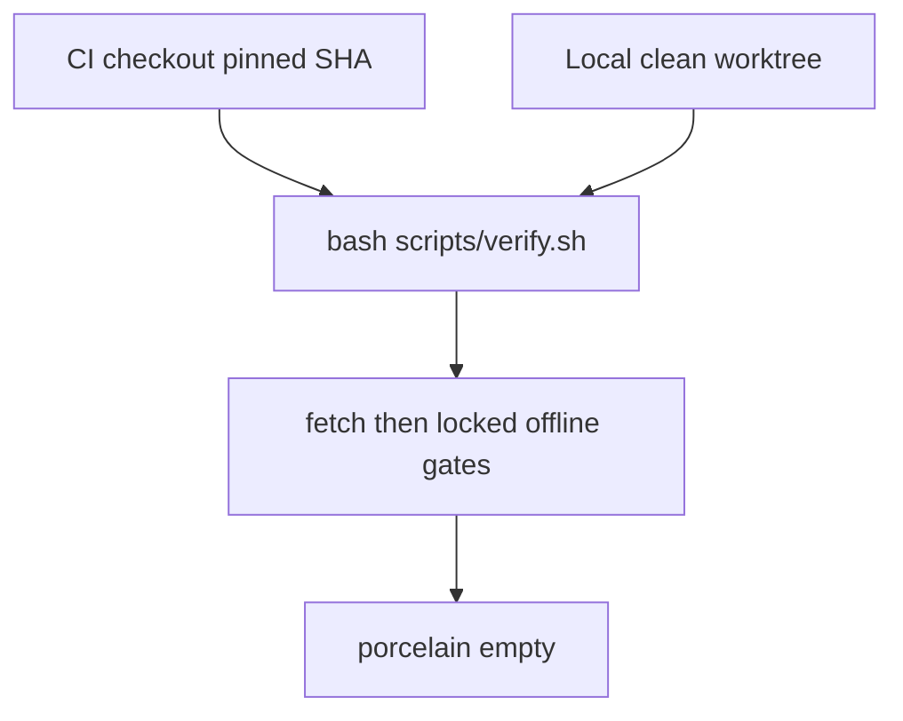

### Report for ORCHESTRATOR_CHAT

Logical whole identity: bookradar-test-hardening-and-ci
Worker session ordinal: 01
Worker exchange ordinal: 01
Persistent role identity: WORKER
Worker session target: fresh-worker-session
Native planning mode: required
Worker session profile: Planner
Phase: planning
Task identity: BOOKRADAR-TEST-HARDENING-AND-CI-PLAN
status: PASS
Phase-qualified result: not-applicable
Start commit: d7d49ab6df2d2fd063644700095d5e55a94e4ae1
End commit: d7d49ab6df2d2fd063644700095d5e55a94e4ae1
Report justification: new-evidence
Logical-whole closure: not-closed

Planning cycle: initial
Prior planning report: none
Targeted revision basis: none
Changed decision boundary: none
Preserved unaffected decisions: none
Automatic targeted revisions used: 0
Plan disposition: approval-gated
Implementation in same Worker session: allowed
Planning stop event: terminal planning report submitted
Execution authority event: explicit ORCHESTRATOR prompt with Native planning mode: not-used
Post-plan implementation session: current-worker-session
Maximum plan-only cycles: 1

Prompt SHA-256: `abf46bdffbddc0a3fac727a66e1e2488b6e4d5a23bbbf73aced511b8424a6b3b` (`01_planning_00.md`). Handout SHA-256 matches the grant: `95e69eb72e4d9b6f8b17c663970f2f2815867c34d6e936a8f50dc8ba581dd3dd`. Predecessor closure SHA-256 matches the grant: `d8c62fb1fef6f1c33d9d9e71e4a6986c90812362e3e0809ae1d9c08fc78d9584`. Both were read as historical evidence.

Changed files: none. Repository mutation: none. Meta write: none. Trace persistence: none; this report is returned in the session for COOPERATOR persistence at `01_report_00.md`.

Validation: read-only inspection only. No `cargo build`, `cargo test`, `cargo fetch`, or `cargo tree`. `target/` remained absent after every command. `cargo +1.99.1 fmt --help` was used only to see flags.

Git result: none. No fetch, stage, commit, push, or submodule update.

Authority expiry: this terminal report ends the planning grant. Client approval, Plan UI acceptance, or a later “implement” message in this chat is not implementation authority. Implementation requires a new complete ORCHESTRATOR prompt with `Native planning mode: not-used`.

## 1. As-found audit and baseline evidence

Directly observed and matching the declared baseline. No RF-12 recovery class applies.

- Physical root: `/Users/agile/Projects/bookradar`. Remote `origin`: `https://github.com/cisarik/bookradar` (fetch and push). Branch `main`. `git status -sb` is `## main...origin/main` with no ahead/behind.
- HEAD, parent, tree, subject: `d7d49ab6df2d2fd063644700095d5e55a94e4ae1`, parent `ed4de54637f22613723bc3df98536a1ac25d0800`, tree `4b8a81d443393ad06eb50b4e97ded598a5bb3931`, subject `fix: update .gitignore to exclude tests target directory`, date `2026-11-12 21:18:30 +0100`.
- Public `git ls-remote origin refs/heads/main` returns the same SHA. Repository API: `visibility=public`, `default_branch=main`.
- Worktree porcelain: empty. `target/` absent. `tests/target/` absent.
- `.ap` gitlink and detached worktree both `d7023cf037f6d17885c3ede5c04812c61640da50`. `git -C .ap symbolic-ref -q HEAD` exits 1. `git -C .ap status -sb` is `## HEAD (no branch)`. `git submodule status` prints `(heads/main)` because that detached commit equals the submodule’s `main` tip, while the checkout stays detached. Submodule porcelain is empty.
- `./.ap/ap doctor` with no argument: `ap doctor: PASS`, including `OK strict pinned AP commit`. The script’s default mode is `strict`.
- Toolchain, after prepending `$HOME/.cargo/bin`: `rustc 1.99.1 (58cf8f9c3 2026-10-13)`, `cargo 1.99.1`, active because of [rust-toolchain.toml](rust-toolchain.toml) (`channel = "1.99.1"`, `profile = "minimal"`, `rustfmt`, `clippy`). Host `cc` and `clang` are Apple clang 21.0.0. The first shell had no `rustc` on `PATH`; that is an environment fact, already documented in the README, and it is why the script must prepend `$HOME/.cargo/bin` when that directory exists.
- [.gitignore](.gitignore) is exactly 15 bytes, `2f 74 65 73 74 73 2f 74 61 72 67 65 74 2f 0a`, one line `/tests/target/`. `git show HEAD -- .gitignore` is a one-line replacement of `/target/` by `/tests/target/`.
- `git check-ignore -v -- tests/target/ tests/target/x` matches `.gitignore:1:/tests/target/`. `target/` and `target/debug/x` produce no match, so neither this file, `.git/info/exclude`, nor a global exclude currently ignores the workspace build directory.
- Absent: `.github`, `scripts`, `justfile`, any local verification script.
- README gate block is a manual list: `cargo +1.99.1 fetch`, then locked offline `build`, `test`, `clippy`, `fmt --all --check`, `tree -p bookradar-core`, and `./.ap/ap doctor`. The synthetic-proof section calls `target/` ignored. That sentence is currently false.
- `cargo +1.99.1 fmt --help` contains neither `--locked` nor `--offline`.
- Test attribute count is 74: 17 in [tests/verification.rs](tests/verification.rs); 7 in [crates/bookradar-store/src/store.rs](crates/bookradar-store/src/store.rs); 3 in [crates/bookradar-store/src/research.rs](crates/bookradar-store/src/research.rs) (`append_only_enforcement_rejects_research_and_observation_mutation`, `unsupported_ledger_version_fails_closed`, `busy_store_rejects_import`); 6 persistence; 13 history; 2 old CLI; 1 research CLI; 5 research contract; 20 research ingestion. They were not executed in this exchange. The predecessor’s passing run remains historical evidence.
- [Cargo.toml](Cargo.toml) has no `[dependencies]` on `bookradar-core`. [Cargo.lock](Cargo.lock) lists `bookradar-core` v0.1.0 with no dependency array. `bookradar-store` depends on `bookradar-core`, `rusqlite`, `serde`, and `serde_json`. Store pins `rusqlite =0.37.0` with `bundled` and default features off.
- CLIs: [bookradar-poc.rs](crates/bookradar-store/src/bin/bookradar-poc.rs) and [bookradar-research.rs](crates/bookradar-store/src/bin/bookradar-research.rs). Empty `history` and empty `current` are implemented and documented (README: exit 0 for empty history and for a non-eligible current reading) and are not process-tested.
- Inspected for the no-product-change boundary: domain contract revision 1 and ADR shapes 0003 and 0004. ADRs 0001–0005 stay untouched. `research_ingestion.rs` was inspected for its 20 test names only and is outside the allowlist.

Not inspected: an authenticated GitHub Actions permission. `GET /repos/cisarik/bookradar/actions/permissions` returned HTTP 401. Whether Actions is enabled is unverified and is not guessed. No cargo command executed the CLIs, so the expected transcripts below are derived from source, not from a process run.

## 2. Test-gap inventory

The existing 74 tests stay. No assertion in them is removed or rewritten. Three new process tests are added. `research_ingestion.rs` is not edited.

Expected transcripts come from the current renderers plus `println!`’s trailing newline. `synthetic_offer()` is source 1 / offer 1. `synthetic_target()` is edition 10. Empty `CurrentView` is conflict `clear`, recheck `clear`, and not eligible. The injected instant `1793548800` is the same integer the existing CLI tests already pass; the empty renderer does not format it, and the CLI still requires a parseable integer. No wall clock.

### `empty_history_exits_zero_with_count_zero`

- File: [crates/bookradar-store/tests/cli.rs](crates/bookradar-store/tests/cli.rs). New function. Uses the existing `run` helper and `common::TempDir`.
- Setup: owned temp directory; `init <temp>/store.sqlite`.
- Then `history <temp>/store.sqlite`.
- Expect exit 0, stdout `synthetic=true offer=1/1 count=0\n`, stderr empty. Init itself must exit 0 before the history assertion.
- Behavior closed: README’s empty-history success exit and the zero-count line of the transcript already locked by `POSITIVE` (`count=4`). The populated history test never executes the empty branch.
- Gap: `positive_transcript_and_negative_fixture_match_the_accepted_plan` runs `history` only after four fixtures.
- Causal: a change to exit 1, an omitted line, or a non-zero count on an initialized empty store would still pass all 74 tests. This is the public empty transcript, not a second copy of `render_history`’s internals.

### `empty_current_exits_zero_with_status_empty`

- Same file and harness.
- Setup: `init <temp>/store.sqlite`, then `current <temp>/store.sqlite 1793548800`.
- Expect exit 0, stdout `synthetic=true offer=1/1 target=10 status=empty\n`, stderr empty.
- Behavior closed: the documented success exit for a current reading with no observations, and the `status=empty` line. Populated tests only lock non-empty `synthetic=true latest_attempt=…` lines.
- Gap: no CLI test initializes a store and calls `current` before `append-fixture`.
- Causal: exit 1, a populated candidate line, or a missing `status=empty` would survive the current suite.

### `empty_research_current_exits_zero_without_candidates`

- File: [crates/bookradar-store/tests/research_cli.rs](crates/bookradar-store/tests/research_cli.rs). New function. Add `mod common;` and use `common::TempDir`.
- Setup: `init <temp>/empty.sqlite`, then `current` with the same arguments the existing test already accepts: `synthetic:producer`, `synthetic:source`, `OFFER-A`, `generation-1`, `10`, `1793548800`.
- Expect exit 0, stdout `candidates=0 conflict=clear recheck=clear verification=not-eligible\n`, stderr empty.
- Behavior closed: an initialized research ledger with no offer still returns a non-eligible current reading at exit 0. Source path: unknown key, `locate_offer` yields none, `history::resolve` of an empty slice, `render_research_current`.
- Gap: the existing test asserts empty `inspect` (`envelopes=0 …`) and asserts `current` only after an import (`candidates=1`).
- Causal: treating a missing offer as `not-found` (exit 1) or inventing a candidate would pass the current research CLI test.

### Cleanup in the existing research CLI test

Keep `research_cli_transcript_and_exits_are_stable` and every current assertion. Replace the `std::env::temp_dir()` plus pid path and the end-of-function `remove_dir_all` with `common::TempDir`. `TempDir`’s `Drop` removes the owned directory during unwind and discards the removal error, so a failed assertion remains the first panic. The current trailing cleanup does not run when an assertion panics, and it can leave `bookradar-research-cli-<pid>` behind. This is the smallest reuse of the guard already used by [cli.rs](crates/bookradar-store/tests/cli.rs). Do not add a test whose only job is to prove `Drop`.

### Evaluated and not added

- `history` on a missing database. `usage_and_storage_failures_use_stable_exits` already requires missing `current` to exit 1 with stderr starting `not-found:`. `history` uses that same read-only `Store::open`.
- A library unit test that calls `render_current` on an empty view. It would lock the same string below the process boundary the README describes.
- Further research-ingestion cases. The 20 existing tests already cover replay, quarantine, conflict, and no auto-verification. No additional contract hole justified another case.
- Coverage percentages, fuzzing, benchmarks, a new harness, or a toolchain bump.

If any new test fails because the process output differs from this source-derived transcript, stop and report it. Do not change product sources, schema, or the renderers to make the test pass.

## 3. `.gitignore` and workspace hygiene

Exact file content, including the final newline:

```text
/target/
/tests/target/
```

`/target/` restores the workspace build directory that `d7d49ab` removed. `/tests/target/` stays. Workspace integration tests compile into `/target/`; the second line is the pattern the maintenance commit added, kept so a cargo invocation inside `tests/` does not become a tracked artifact. No `.git/info/exclude`, no global exclude, no `git clean`.

Proof, in this order, after the file is written and before any product-code edit:

- `git check-ignore -v -- target/debug/ignored` names pattern `/target/`.
- `git check-ignore -v -- tests/target/ignored` names pattern `/tests/target/`.
- `git check-ignore -q -- README.md` is non-matching, so a broad ignore cannot satisfy the check.
- The same two pattern checks live in `scripts/verify.sh`, so a later edit that drops `/target/` fails before the suite.
- The script’s final `git status --porcelain` must be empty. A real `cargo build` creates `target/`; if `/target/` is missing again, that directory shows up as untracked and the script exits non-zero. That is the behavioral proof of the known regression.

The pattern check uses the `source:line:pattern` field from `git check-ignore -v` and requires the pattern token to be exactly `/target/` or `/tests/target/`. A substring search for `/target/` would also match `/tests/target/`.

## 4. Local verification path and CI parity

One source of truth: [scripts/verify.sh](scripts/verify.sh), interpreter `bash`, shebang `#!/usr/bin/env bash`, invoked as `bash scripts/verify.sh` both locally and in CI so the executable bit is not load-bearing. `set -euo pipefail`. No `continue-on-error`. The workflow does not restate cargo flags.

Dirty worktree: if `git status --porcelain` is non-empty, print it to stderr and exit 2 before PATH changes, ignore checks, or cargo. Do not stash, reset, or clean. A pre-existing dirty tree would let a before/after comparison miss `target/` that was already untracked. CI’s checkout is clean. The local full-script demonstration runs only after the implementation commit, when the worktree is clean again. During implementation, the new tests may be run with a focused `cargo test` before that commit; that focused run is not a substitute for the script.



## 5. CI platform, OS, pins, Rust, fetch, cache, triggers, permissions

Platform: GitHub Actions. The canonical repository is public GitHub. No other platform is justified.

OS: one job, `runs-on: ubuntu-24.04`. Not `ubuntu-latest`, because that label moves. Not macOS in this slice. The image readme at `actions/runner-images` commit `da61d64427786d1ab044a9880e6db8521f5b6995` (2026-11-13) lists Rust 1.99.1, Rustup 1.29.2, Clang 16.0.6, and GNU C++ 12.4.0, which is enough for bundled SQLite’s C build. Public standard-runner minutes are the cost unit; one Linux job is the smallest bill. macOS would add a second image and mostly repeat the maintainer’s Darwin host. Ubuntu is the platform the local Mac does not already prove. Image contents can still change inside `ubuntu-24.04`; the script’s `rustc 1.99.1` check fails closed if the toolchain selector is wrong, and `cargo +1.99.1 fetch --locked` may download that exact toolchain when rustup is present.

Triggers: `push` to `main`, `pull_request` to `main`, and `workflow_dispatch` with no inputs. Concurrency group `verify-${{ github.workflow }}-${{ github.ref }}`. `cancel-in-progress` is true only when `github.event_name == 'pull_request'`, so a main publication run is not cancelled by a later push. Job `timeout-minutes: 20`.

Permissions: workflow-level `permissions: contents: read` only. No job-level expansion. No `pull_request_target`, `schedule`, environment, deployment, release, or `secrets` context.

Checkout pin, the only third-party action used:

- `actions/checkout@3d3c42e5aac5ba805825da76410c181273ba90b1`
- Evidence: Git ref API `refs/tags/v7.0.1` has `object.type=commit` and that SHA; commits API subject is `prep v7.0.1 release (#2531)`; release `v7.0.1` published 2026-07-20. The workflow comment may say `v7.0.1`. The SHA is the pin. The floating tags `v4` and `v7` are not used. The older `v4` tag currently resolves to `11d5960a326750d5838078e36cf38b85af677262` and is not selected.
- Inputs at that SHA, confirmed in `action.yml`: `persist-credentials` exists and defaults to true, so the workflow sets `false`. `submodules` exists and defaults to false, so the workflow sets `recursive` (only public `.ap`). `fetch-depth` exists and defaults to 1; set `1` explicitly. `clean` stays at its default `true` on the fresh runner. No `ssh-key`, no `token` override.

Rust setup: no third-party Rust action. The runner’s rustup reads [rust-toolchain.toml](rust-toolchain.toml). The script refuses a compiler whose version does not start with `rustc 1.99.1`. Rejected alternative, resolved so it is not a guess: `dtolnay/rust-toolchain` tag `v1` currently points at `683b588c487a69d01f6c6ddf40f036ff682cc2c8` (“Add 1.99.1 patch release”, committer date 2026-10-16). That `v1` tag moves, so it would still need a SHA pin, and it adds a second supply-chain entry the image readme makes unnecessary.

Fetch and offline boundary: network is allowed for checkout, for rustup’s toolchain download if the exact toolchain is absent, and for `cargo +1.99.1 fetch --locked`. Build, test, clippy, and `cargo tree` then use `--locked --offline`. Tests stay offline. `fmt` stays `cargo +1.99.1 fmt --all --check` because 1.99.1’s fmt help has no `--locked` or `--offline`.

Cache: none. Rejected alternatives, both resolved: `actions/cache` `v6.1.0` is `55cc8345863c7cc4c66a329aec7e433d2d1c52a9`; `Swatinem/rust-cache` `v2.9.3` is `d1527c8f67ef9af357290475d4af4b0fab8f12e0`. A cache would add another pin and can hide a cold-runner failure. The workspace is small; the extra cost is one bundled-SQLite compile per run, inside the 20-minute timeout.

The verify step sets `GITHUB_TOKEN: ""` so the script and tests do not read the job token. Checkout still has the default token only for the checkout step, and `persist-credentials: false` keeps it out of `.git/config`. Other automatic Actions runtime tokens can exist in the hosted environment; the workflow does not name, echo, or persist them.

## 6. Exact step order and script outline

Workflow `.github/workflows/verify.yml`, name `verify`:

1. Checkout at the SHA above with `submodules: recursive`, `persist-credentials: false`, `fetch-depth: 1`.
2. `bash scripts/verify.sh` with `GITHUB_TOKEN` empty. One step. Fail fast.

Script order:

1. `cd` to the repository root from the script’s directory.
2. Exit 2 when porcelain is non-empty.
3. Prepend `$HOME/.cargo/bin` when that directory exists.
4. Require `rustc --version` to start with `rustc 1.99.1` and require `cargo +1.99.1 --version` to succeed.
5. Require `git check-ignore -v` pattern tokens `/target/` and `/tests/target/` on `target/debug/ignored` and `tests/target/ignored`. Require `README.md` to be unignored.
6. `cargo +1.99.1 fetch --locked`.
7. `cargo +1.99.1 build --workspace --all-targets --locked --offline`.
8. `cargo +1.99.1 test --workspace --locked --offline`.
9. `cargo +1.99.1 fmt --all --check`.
10. `cargo +1.99.1 clippy --workspace --all-targets --locked --offline -- -D warnings`.
11. Core tree: capture `cargo +1.99.1 tree --locked --offline -p bookradar-core`. Require exactly one line and the prefix `bookradar-core v0.1.0 (`. The parenthesized path differs between a Mac checkout and `/home/runner/work/...`, so the path is not an exact string. A second line means a dependency appeared.
12. `git diff --check`.
13. `./.ap/ap doctor` with no `--candidate`, which is strict mode. Non-zero fails the script.
14. `git status --porcelain` empty. This is the clean-worktree gate that fails when a build emits an untracked `target/`.

`ap doctor` uses the gitlink, the worktree HEAD, cleanliness, and `AGENTS.md`. It does not walk history, so `fetch-depth: 1` is sufficient. If the first real CI checkout fails the submodule or the doctor, stop and report that output; do not deepen the fetch or change the pin inside the same attempt without a new decision.

## 7. Test infrastructure and determinism

All three new tests and the adjusted research CLI test use `common::TempDir`: a private directory under the system temp dir, named with pid and an atomic counter, created with `create_dir`, and removed in `Drop`. They do not share a global database path. Times are the integer `1793548800`. Identifiers are the synthetic ones the existing research test already uses (`synthetic:producer`, `synthetic:source`, `OFFER-A`, `generation-1`, edition `10`). No network, credentials, wall clock, or retail data. Each test is one process sequence in its own integration-test binary. Cleanup failure is ignored inside `Drop`, so it cannot replace the assertion panic. The new tests do not delete the temp directory themselves.

## 8. Documentation and ADR

README, in [README.md](README.md):

- State that `bash scripts/verify.sh` is the only local and CI gate. Describe in prose what it proves. Do not paste a second copy of the cargo flag list.
- Keep the PATH note for `$HOME/.cargo/bin`.
- Replace the false “ignored `target/`” claim with the two-line rationale: `/target/` is the workspace build directory; `/tests/target/` remains for a nested `tests/` cargo output. Current workspace tests compile into `/target/`.
- Name the workflow `verify`, the triggers, `ubuntu-24.04`, `contents: read`, the checkout SHA, the absence of cache, secrets, deployment, and schedule, and the 20-minute timeout.
- Say explicitly that this README does not claim a green public run. A badge is omitted in this slice. A badge before the first observed run would point at a workflow that has not yet executed. Adding one after a green run is a separate later change.
- Leave the synthetic CLI examples. Leave license, contribution, privacy, security-response, support, and release policy absent.

ADR: add [docs/adr/0006-verification-gate-and-ci.md](docs/adr/0006-verification-gate-and-ci.md) only in the implementation grant after the Cooperator accepts the policy below. Follow the lifecycle shape of ADR 0004. Decision owner: COOPERATOR. Do not mark it Accepted unless that grant records the acceptance. Contents: one bash script is the gate; GitHub Actions on `ubuntu-24.04`; `actions/checkout` pinned to `3d3c42e5aac5ba805825da76410c181273ba90b1`; `contents: read`; no cache; no third-party Rust action; strict `ap doctor`; clean porcelain after the gates. Alternatives recorded: `ubuntu-latest`, a macOS job, `dtolnay/rust-toolchain`, `actions/cache`, `Swatinem/rust-cache`, and duplicating commands in YAML. Do not edit the domain contract or ADRs 0001–0005. Link the new ADR from the README next to the gate paragraph.

## 9. Evidence tier, acceptance, and post-publication CI evidence

Tier: E2. The test additions and the gitignore correction would be E1. The slice also crosses a public CI trust boundary: a third-party action, remote execution, and a public status surface. That is cross-cutting and reversible. It is not E3: no secret, production host, privilege change, or durable migration. A normal non-force push of this bounded commit can stay inside E2 when public equality is checked.

Fresh independent acceptance is recommended before publication, because the action pin and the permission block are the remaining supply-chain uncertainty. E2’s minimum does not force an audit; the recommendation is the uncertainty, not the file count. Implementation evidence from the planning session, if reused, is non-independent. `Independence required` on this planning grant is `no`.

Acceptance matrix, all required on the implementation candidate:

- Baseline remains the parent of the new commit, or the new commit’s parent is `d7d49ab6df2d2fd063644700095d5e55a94e4ae1`. AP pin unchanged. Strict `ap doctor` PASS.
- The 74 existing tests still run inside `cargo test --workspace --locked --offline`. The three new tests pass with the exact stdout, empty stderr, and exit 0 above.
- `git check-ignore -v` names `/target/` and `/tests/target/`. `README.md` is not ignored. After the script, porcelain is empty and `target/` exists on disk as an ignored directory.
- Negative local probe, after the commit and outside CI: create an untracked unignored file, expect `bash scripts/verify.sh` to exit 2 before cargo, then delete that file. A missing deletion is part of the result. CI does not create this file.
- Script and workflow contain one command path. YAML has no second cargo list.
- Workflow text: the checkout SHA, `contents: read`, `persist-credentials: false`, `submodules: recursive`, no `pull_request_target`, no `schedule`, no `secrets.`, no cache action, `ubuntu-24.04`, timeout 20.
- Diff has no changes under `src/`, `crates/bookradar-store/src/`, `Cargo.toml`, `Cargo.lock`, `rust-toolchain.toml`, `.ap`, `docs/domain-contract.md`, or ADRs 0001–0005.
- The script was executed locally on the clean post-commit tree and exited 0. That execution is the implementation evidence. This planning report does not claim it.

Post-publication evidence is separate and is not produced by merging YAML. After a publication grant’s non-force push, observe the workflow run directly (`gh run list --repo cisarik/bookradar --workflow verify.yml --branch main`, or the Actions run page) and record the run URL, head SHA, and conclusion. Do not claim the workflow is active from the file. If no run appears, the unverified Actions setting is the first place to look; do not “fix” that by widening permissions.

## 10. Allowlist, stages, rollback, commit subject

Allowlist:

- `.gitignore`
- `scripts/verify.sh`
- `.github/workflows/verify.yml`
- `crates/bookradar-store/tests/cli.rs`
- `crates/bookradar-store/tests/research_cli.rs`
- `README.md`
- `docs/adr/0006-verification-gate-and-ci.md`

No other path. `tests/common/mod.rs` is reused and not modified.

Stages, each failing closed before the next:

1. Write `.gitignore`. Run the three `git check-ignore` checks. Do not build yet.
2. Add the three tests and the `TempDir` change. Run `cargo +1.99.1 test --locked --offline -p bookradar-store --test cli --test research_cli`. This creates `target/`. Porcelain must not list it. If a new test fails on output, stop; do not edit product code.
3. Add `scripts/verify.sh`, the workflow, the README, and the ADR.
4. Local commit, only if the implementation grant includes that Git write. Subject: `fix: restore target ignore and run the gates in CI`. One commit. No amend, rebase, tag, or extra ref.
5. Dirty-file probe: expect exit 2, then remove the probe file. Then `bash scripts/verify.sh` on the clean commit. Expect exit 0 and empty porcelain.
6. Stop. Publication is a later grant: prove public `main` is still `d7d49ab6df2d2fd063644700095d5e55a94e4ae1`, then one non-force push of that commit. Observe the run afterward.

Rollback: before the commit, leave the listed files unstaged and stop. After the local commit and before push, do not reset or force; report the commit and stop. After a pushed commit, rollback is a later `git revert` plus a separate non-force push, never a force push.

Proposed commit subject: `fix: restore target ignore and run the gates in CI`

## 11. Decision table

Each row is a Cooperator decision. The recommendation is what the implementation grant should copy if it accepts this plan.

- Platform. Recommend GitHub Actions. Alternative: another CI host. Evidence: canonical remote is `https://github.com/cisarik/bookradar`, public. Cost/risk: low; one public workflow. Decision: accept GitHub Actions.
- OS matrix. Recommend `ubuntu-24.04` only. Alternatives: `ubuntu-latest`; add `macos-latest`. Evidence: runner-images `da61d64427786d1ab044a9880e6db8521f5b6995` lists Rust 1.99.1, Rustup, and Clang/GNU C++. Cost/risk: one job; a floating label or a second OS can wait. Decision: accept Ubuntu 24.04 only.
- Action pin. Recommend `actions/checkout@3d3c42e5aac5ba805825da76410c181273ba90b1` with `submodules: recursive`, `persist-credentials: false`, `fetch-depth: 1`. Alternatives: floating `v7` or `v4` (`11d5960a…`). Evidence: tag `v7.0.1` is that commit; `action.yml` at that SHA has those inputs. Decision: accept this SHA and these inputs.
- Rust setup. Recommend runner rustup plus `rust-toolchain.toml` and a script version check. Alternative: `dtolnay/rust-toolchain` at `683b588c487a69d01f6c6ddf40f036ff682cc2c8`. Evidence: image readme already lists Rust 1.99.1. Decision: accept no third-party Rust action.
- Cache. Recommend none. Alternatives: `actions/cache@55cc8345863c7cc4c66a329aec7e433d2d1c52a9`; `Swatinem/rust-cache@d1527c8f67ef9af357290475d4af4b0fab8f12e0`. Cost/risk: colder builds, smaller supply chain. Decision: accept no cache.
- Local script versus YAML. Recommend `bash scripts/verify.sh` as the only gate. Alternative: duplicate the commands in the workflow. Decision: accept the script.
- Test scope. Recommend the three named tests plus `TempDir` in the existing research CLI test. Preserve 74. Alternative: stop at gitignore and CI, or expand into the ingestion file. Decision: accept these three tests and the cleanup change.
- ADR. Recommend ADR 0006 for the gate policy, written only after acceptance. Alternative: README only. Decision: accept ADR 0006 and leave 0001–0005 and the domain contract unchanged.
- Evidence tier and independence. Recommend E2 and a fresh independent acceptance before publication. Alternative: E1 with no fresh acceptance. Decision: accept E2 and whether the fresh acceptance is required before the publication grant.
- Publication. Recommend one later non-force push, then a directly observed run. This plan does not publish. Decision: keep publication in a separate grant.
- Badge. Recommend none in this commit. Alternative: a status badge in the README now. Decision: accept omitting the badge until a green run is observed.
- Actions enablement. Unverified (HTTP 401). Recommend no settings change in the Worker grant. Decision: Cooperator confirms Actions is enabled before expecting a run, or accepts that a missing run is a settings finding.

## 12. Residual risks, open questions, and the smallest next step

- Actions enablement and branch protection are unread. The workflow file cannot prove them. A missing run after push is a settings fact, not a reason to add write permission.
- Hosted-runner images move inside `ubuntu-24.04`. The script’s toolchain check is the fail-closed response. The readme evidence is one commit, `da61d64427786d1ab044a9880e6db8521f5b6995`, not a permanent software pin.
- Empty CLI stdout is source-derived. The implementation run is the first execution. A mismatch stops the slice.
- `persist-credentials: false` and an empty `GITHUB_TOKEN` on the script step do not erase every automatic Actions token in the runner environment.
- Shallow checkout plus submodule init is specified from `action.yml` and from `ap doctor` not needing history. The first real run is still the proof.
- The automatic `GITHUB_TOKEN` of a public repository remains `contents: read` for the job. The workflow never asks it to write.
- This exchange wrote two disposable local files outside the repository while reading help and an API body: `/tmp/bookradar-fmt-help.txt` and `/tmp/br-actions.json`. They are not repository artifacts and were not deleted, because this grant authorizes no cleanup mutation.

Smallest next step: the Orchestrator reconciles section 11 with the Cooperator and, on acceptance, issues one implementation prompt to this current Worker session with `Native planning mode: not-used`, the allowlist above, the accepted SHA and OS, Git authority limited to the one local commit, and publication absent.

Orchestration critique:
MEASURED: none
LEAD: GitHub Actions permissions for `cisarik/bookradar` returned HTTP 401 to an unauthenticated read; cheapest useful check is one authenticated `GET /repos/cisarik/bookradar/actions/permissions` before a publication grant, not before accepting this plan.

Resolved Execution Issues / Near-Misses: the first toolchain command did not see `rustc` because this shell’s `PATH` omits `$HOME/.cargo/bin` (`rustc` exit 127, and `ap doctor` did not run in that command). Cause: non-login `PATH`, already described by the README. Resolution: reran with the directory prepended; `rustc 1.99.1` and strict `ap doctor: PASS`. Residual: `scripts/verify.sh` prepends that directory when it exists. Two `/tmp` reader files were created and left in place.
Pre-Existing Failure Classification: none
Authority expiry: this terminal report ends the grant; no autonomous continuation.
