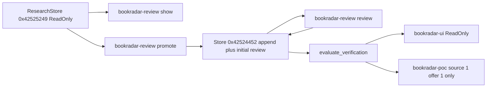

### Report for ORCHESTRATOR_CHAT

Logical whole identity: bookradar-review-and-promotion-workflow
Worker session ordinal: 01
Worker exchange ordinal: 01
Persistent role identity: WORKER
Worker session target: fresh-worker-session
Native planning mode: required
Worker session profile: Planner
Phase: planning
Task identity: BOOKRADAR-REVIEW-PROMOTION-PLAN
status: PASS
Phase-qualified result: not-applicable
Start commit: 2281982f7dae0ef1f582d294592c41281ba11b21
End commit: 2281982f7dae0ef1f582d294592c41281ba11b21
Changed files: none
Tests and validation: read-only identity, public ref, CI run 43485796198 conclusion success, strict `./.ap/ap doctor` PASS, Rust 1.99.1; `bash scripts/verify.sh` was not re-run; the Orchestrator’s 94-pass measurement is cited as measured baseline evidence
Git result: none
Deviations, risks, or missing evidence: no RF-12 baseline difference; six product decisions remain open and are recommended below, not treated as granted; report-file readback happens only after the client permits the one Meta write
Smallest next step: Orchestrator presents the material decision table to the COOPERATOR; no implementation grant until those cells are decided
Report justification: new-evidence
Logical-whole closure: not-closed
Authority expiry: this terminal report ends the planning grant; no autonomous continuation.
Orchestration critique:
MEASURED: none
LEAD: none
Resolved Execution Issues / Near-Misses: native Plan Mode blocks the Meta report write until plan approval; the grant tells the Worker to keep the complete report in the plan output and write it once the client permits; residual risk is that file delivery stays unverified until that readback
Pre-Existing Failure Classification: none

Prompt SHA-256: `6547216bbc79798733fc6d4fb67b9bb505eb235cf3a56f828617c5aec9d1e922`
Handout SHA-256 verified: `ea5985ff63853098c8f2de5dc59977a30d5374acc0f812f23107e70656e997fd`
Predecessor closure SHA-256 verified: `77332b58b403ccf30647d17883f3f8e4e008a9efac81be453148e8d29e37f49f`
Native planning mode observed at start: active.

Planning record: `Planning cycle: initial`; `Prior planning report: none`; `Targeted revision basis: none`; `Changed decision boundary: none`; `Preserved unaffected decisions: none`; `Automatic targeted revisions used: 0`.

## 1. As-found state and 94-test baseline

Independently verified on `/Users/agile/Projects/bookradar`:

- root and `origin` `https://github.com/cisarik/bookradar`; branch `main`
- HEAD `2281982f7dae0ef1f582d294592c41281ba11b21`, parent `a2182302de73cb345b4b646993a1ad25d602555f`, tree `b6e2e169a3670d07a1e16afcaeddd50d368a72d6`, subject `feat: add a local read-only UI shell`
- `git status --porcelain` empty; `.ap` gitlink and detached HEAD `d7023cf037f6d17885c3ede5c04812c61640da50`; submodule porcelain empty; strict `./.ap/ap doctor` PASS, variant `stable`
- `.gitignore` has `/target/` and `/tests/target/`; no `ap.project.conf`; root [AGENTS.md](/Users/agile/Projects/bookradar/AGENTS.md) has no upgrade ledger outside the managed block
- `rustc`/`cargo` `1.99.1`
- `git ls-remote origin HEAD refs/heads/main` both `2281982f7dae0ef1f582d294592c41281ba11b21`
- `gh api repos/cisarik/bookradar/actions/runs/43485796198`: workflow `verify`, `completed`, `success`, head SHA matches, branch `main`
- report path absent, destination is a real directory and not a symlink

`scripts/verify.sh` was not executed here. The Orchestrator’s measured result stands: exit 0, 94 tests. Inventory recount of `#[test]` matches that split: 17 `tests/verification.rs`, 7 `store.rs`, 3 `research.rs`, 4 `tests/cli.rs`, 13 `tests/history.rs`, 6 `tests/persistence.rs`, 2 `tests/research_cli.rs`, 5 `tests/research_contract.rs`, 20 `tests/research_ingestion.rs`, 3 UI CLI, 6 UI HTTP, 8 UI render. No discrepancy with the handout or [01_closure.md](/Users/agile/meta/projects/bookradar/00/06-bookradar-ui-shell/01_closure.md).

Surfaces the slice may touch, and what they already do:

- [src/verification.rs](/Users/agile/Projects/bookradar/src/verification.rs) `evaluate_verification` is the only eligibility authority. `EvidenceMethod::AgentOnly` returns `NotEligible` inside `policy_matches`.
- [crates/bookradar-store/src/store.rs](/Users/agile/Projects/bookradar/crates/bookradar-store/src/store.rs): `Store::append` writes one observation and an optional revision-1 review in one immediate transaction. `Store::append_review` requires `expected_revision == MAX(revision)` (`0` when none), rejects a regressed `assessed_at` as `InvalidReview { reason: "assessment-time-regressed" }` (category `storage`), and returns `ReviewRevisionConflict` (category `review-conflict`). `insert_registries` inserts source, edition, and offer with `ON CONFLICT DO NOTHING` in that same transaction.
- [crates/bookradar-store/src/history.rs](/Users/agile/Projects/bookradar/crates/bookradar-store/src/history.rs): `is_rejected` drops an observation from an equal-time incompatible pair. Latest `Disputed` keeps `ConflictState::Unresolved` until a later revision is `Supported` or `Rejected`. `stock_claim` can still render historical “Last observed available” for a `Supported` Slovak resolved readable claim without checking evidence method. Checked-available wording comes only from `Eligibility::Eligible`.
- [crates/bookradar-store/src/research.rs](/Users/agile/Projects/bookradar/crates/bookradar-store/src/research.rs): ledger application id `0x42525249`, `user_version = 1`, `EXPECTED_OBJECTS` includes the v1 tables plus research tables and append-only triggers. `project_candidate` writes ledger-local rows with `EvidenceMethod::AgentOnly`, knowledge `Unreviewed`, assessor `rule:research-admission-v1`, and provenance `research:{receipt}/{position}`. Those ids are not application-store ids. `FindingView` exposes receipt, position, outcome, reason, knowledge, canonical bytes, and ledger `observation_id` only.
- CLIs: [bookradar-poc.rs](/Users/agile/Projects/bookradar/crates/bookradar-store/src/bin/bookradar-poc.rs) is `init`, `append-fixture`, `current`, `history` on `synthetic_offer()` (source 1, offer 1). [bookradar-research.rs](/Users/agile/Projects/bookradar/crates/bookradar-store/src/bin/bookradar-research.rs) is `init`, `import`, `inspect`, `current`. Exit 2 before I/O, exit 1 for store/filesystem, import exit 3 when rejected, quarantined, or `seen` is unknown.
- Schemas [schema_v1.sql](/Users/agile/Projects/bookradar/crates/bookradar-store/src/schema_v1.sql) and [schema_research_v1.sql](/Users/agile/Projects/bookradar/crates/bookradar-store/src/schema_research_v1.sql) already store every fact this slice needs. `provenance_reference TEXT NOT NULL` has no length cap beyond `require_text` (non-empty, no NUL).
- UI [config.rs](/Users/agile/Projects/bookradar/crates/bookradar-ui/src/config.rs) validates flags before I/O and says the observation offer is source 1, offer 1. [snapshot.rs](/Users/agile/Projects/bookradar/crates/bookradar-ui/src/snapshot.rs) `load_observations` calls `synthetic_offer()`. [render.rs](/Users/agile/Projects/bookradar/crates/bookradar-ui/src/render.rs) prints that same hardcoded offer. Both databases open `OpenMode::ReadOnly`.

No product defect requiring a kernel or schema change was found. ADR 0005 already defers ledger dispute resolution and says this ledger has no resolution command.

## 2. Functional slice and command/API surface

Compared options:

- Extend `bookradar-poc`: would reopen ADR 0004’s four-command proof. No concrete reason to do that.
- Extend `bookradar-research`: would mix untrusted import (exit 3) with a trusted write to the other database, and its source comment fixes four commands.
- Library only: correct core, but the handout’s operator flow would have no executable path.
- One new binary plus additive library methods: smallest operator surface that leaves both existing CLIs unchanged.

Recommendation: add `bookradar-review` in `bookradar-store` with exactly three commands, `show`, `promote`, and `review`. No fourth command. No duplicate of `init`, `import`, `inspect`, `current`, `append-fixture`, or `history`.

Library additions:

- `ResearchStore::candidate(&CandidateQuery) -> Result<Option<CandidateRecord>, StoreError>` in [research.rs](/Users/agile/Projects/bookradar/crates/bookradar-store/src/research.rs). Query is producer, run, finding, receipt, and position. SQL selects that primary key and checks the identity columns. `CandidateRecord` carries those identities, outcome, reason, latest ledger knowledge (same `CASE` as `read_snapshot`), canonical bytes, source/listing refs, and ledger-local source/offer/observation ids. `None` means no match.
- New [crates/bookradar-store/src/promotion.rs](/Users/agile/Projects/bookradar/crates/bookradar-store/src/promotion.rs) with `promote(&mut ResearchStore, &mut Store, &PromotionRequest) -> Result<(), ReviewWorkflowError>` and `append_application_review(...)` as a thin wrapper over `Store::append_review`. Export both from [lib.rs](/Users/agile/Projects/bookradar/crates/bookradar-store/src/lib.rs).

`ReviewWorkflowError` is `Store(StoreError)` or `Refused { reason }`. Categories are the reason token or the inner store category. CLI maps `Usage` to exit 2 before any database open, and every `ReviewWorkflowError` to exit 1. Do not reuse import exit 3.

`show --ledger <path> --producer <id> --run <id> --finding <id> --receipt <u64> --position <u64>`

- Identifiers use the existing `is_identifier` grammar (1..=128, ASCII alphanumeric plus `.` `_` `:` `-`, first character alphanumeric). Ids reject `0`, `+`, `-`, non-numeric, and values above `i64::MAX`.
- Opens the ledger `ReadOnly` only after those checks. Prints stable `key=value` lines: producer, run, finding, receipt, position, outcome, reason, ledger_knowledge, source_ref, listing_ref, listing_generation, ledger_source_id, ledger_offer_id, ledger_observation_id, canonical_len. Canonical bytes are printed only as escaped data on `canonical=`, with controls escaped, never executed. Missing row: stderr `unknown-finding: ...`, exit 1, no other file opened.

`promote` writes one application observation plus its initial `Supported` review only when every attestation flag is present. Required flags, no JSON defaults:

- `--ledger`, `--store`
- `--producer`, `--run`, `--finding`, `--receipt`, `--position`
- `--source-id`, `--offer-id`, `--observation-id` (positive, fit in `i64`)
- `--edition-id` (resolved subject only)
- `--language slovak` only
- `--access readable`, `--listing present`, `--availability available`
- `--source-statement <nonempty, no NUL>`
- `--evidence-method direct-browser|manual`
- `--evidence-reference <nonempty>`
- `--cover-subject`, `--cover-language`, `--cover-availability` as boolean presence flags; all three required
- `--reviewer-approval`, `--assessor`, `--rationale` nonempty
- `--observed-at <unix seconds>`, `--observed-offset <i32 seconds in the existing core range>`
- `--captured-at` and `--captured-offset` optional; when omitted they copy the reviewer-supplied observed stamp, not the agent stamp
- `--ingested-at`, `--assessed-at`, `--recorded-at` unix seconds
- knowledge is fixed `supported`; there is no flag to set `AgentOnly`, `unreviewed`, `disputed`, or `rejected` on this command

Usage failures (unknown flag, duplicate flag, missing value, bad token, empty text, `agent-only`, non-slovak, other access/listing/availability) exit 2 before either database is opened. After usage checks: open ledger `ReadOnly`, read the candidate, run `promote` checks, and only then open the store `ReadWrite` and call `Store::append`. Policy failure does not open the store.

`review --store <path> --source-id --offer-id --observation-id --expected-revision <u64> --knowledge supported|disputed|rejected --assessor --rationale --assessed-at --recorded-at [--reviewer-approval]`

- `--reviewer-approval` is required when knowledge is `supported`, and optional otherwise. Missing required approval is exit 2 before I/O.
- Opens only the application store `ReadWrite`. Calls `Store::append_review`. First stored revision is already 1 when `promote` wrote the initial review, so the next call passes `--expected-revision 1`. A bare observation with no review still uses `0`, matching the library.
- stderr prefixes: `review-conflict`, `storage` for `assessment-time-regressed`, `not-found`, `filesystem`, `duplicate-key` only if a store constraint reports it.

Inspection:

- `bookradar-poc current` and `history` stay on source 1, offer 1. A promotion onto that offer in a fresh store is visible there with no poc change. Any other offer is invisible to poc.
- `bookradar-ui` with `--source-id` and `--offer-id` renders history and current for that offer. The README demo uses a fresh store, source 1, offer 1, observation 1, edition 10, so both tools show the same row, plus one UI-only example on source 2, offer 7.

Provenance written by `promote`, and nothing else from the finding:

`research:<producer_id>/<run_id>/<finding_id>@<receipt_id>/<position>`

Identifiers cannot contain `/` or `@`. Receipt and position are decimal. The string is public-safe: no URL, no claim text, no canonical JSON. Requested URL, resolved URL, redirect, and uncertainty stay absent on the promoted row. Canonical bytes stay in the ledger.

## 3. Trust boundary and anti-auto-promotion invariants

`promote` builds `Observation` and `ReviewDraft` only from the reviewer flags. It does not read subject, language, access, listing, availability, statement, coverage, evidence method, or timestamps out of canonical JSON. `project_evidence` already forces `AgentOnly` inside the ledger; that value is never copied.

Enforcement before `Store::append`:

- outcome must be exactly `admitted`; `rejected`, `quarantined`, and `replayed` return `not-admitted` and do not open the store
- missing or mismatched `(producer, run, finding, receipt, position)` returns `unknown-finding`
- evidence method must be `DirectBrowser` or `Manual`; `AgentOnly` returns `agent-only-evidence` even if a library caller also sets `Supported` and `ReviewerApproval`
- language Slovak, resolved edition, readable access, present listing, available stock, nonempty statement, nonempty evidence reference, all three claims `Covered`, `Supported`, and `ReviewerApproval` are required together; anything else returns `incomplete-attestation`
- access-failure tokens are not accepted by the command, so they cannot be stored as `Unavailable`
- `evaluate_verification` stays the only eligibility function; the new code calls `Store::current`, which already calls it; no second freshness or eligibility implementation

Why full attestation at promotion is the recommendation: evidence method lives on the immutable observation. A later review can change knowledge and approval, not `AgentOnly` into `Manual`. An `AgentOnly` plus `Supported` row can still pass `stock_claim` and show “Last observed available” without becoming `Eligible`. Copying an unreviewed agent row into `0x42524452` would duplicate untrusted ledger state and could never become checked-available. The domain pipeline’s attributed observation is the reviewer-attested row, not a copy of the agent row.

Refused promotion: exit 1, category as above, ledger file bytes unchanged, application store not opened. Successful promotion commits only inside the existing `Store::append` transaction.

Ledger dispute is a separate decision (below). Recommendation: `show` prints `ledger_knowledge=disputed`, and `promote` of an `admitted` row stays allowed. ADR 0005 leaves ledger disputes without a resolution command. Blocking on that flag would make the candidate unpromotable forever. The dispute remains visible untrusted evidence; it is not application truth.

A stale reviewer-supplied `observed_at` is stored and stays `NotEligible` / historical. The command does not refuse history. A fresh timestamp inside 24 hours, with conflict and recheck clear, is what `Store::current` renders as `Checked available — Unix …; expires at Unix …`.

## 4. Database schemas, append-only triggers, and provenance

No migration. `Store::open` and `ResearchStore::open` keep `user_version = 1` and the current `EXPECTED_OBJECTS`. v1 columns already hold subject, edition, language, access, listing, availability, statement, evidence method and reference, three coverage bits, timestamps, provenance, and review revision, assessor, rationale, and approval.

Duplicate `(source_id, offer_id, observation_id)` hits the primary key, `map_failure` returns `DuplicateKey` (`duplicate-key`), and the immediate transaction rolls back registry inserts from that attempt. An existing source, edition, or offer is not a duplicate; `ON CONFLICT DO NOTHING` keeps it. A second observation id for the same finding is a new observation, not a duplicate. There is no unique index on `provenance_reference`, and adding one would be a schema change. Do not add one.

Transaction order: ledger `ReadOnly`; validate; store `ReadWrite`; one `append` transaction; no ledger write method is called; commit only after the insert; any error rolls back that transaction.

`FindingView` is not enough for `show`. The additive `candidate` read is the smallest API. It does not alter ledger rows.

## 5. Conflict resolution and review revisions

Existing behavior to preserve and expose through `review`:

- `expected_revision == 0` inserts revision 1; `promote` already inserts revision 1, so the next review passes the current max
- wrong `expected_revision` returns `review-conflict` and writes nothing
- `assessed_at` earlier than the previous revision returns `storage` / `assessment-time-regressed`
- `Rejected` makes `is_rejected` true, so `group_conflicts` no longer treats that observation as an equal-time incompatible partner (`history.rs` `equal_time_conflict_survives_until_explicit_rejection` already covers the library)
- latest `Disputed` stays unresolved; a later `Supported` or `Rejected` on that same observation replaces latest knowledge; older `reviews` rows stay
- the command supplies assessor, rationale, optional approval, and both instants; no clock read

Human revisions belong only in `0x42524452`. `ResearchStore` gains no `append_review`. A ledger review surface would create a second application truth inside an untrusted file and would need schema-compatible writes the admission triggers do not expect from a reviewer. Read-only `candidate` is the only ledger addition.

## 6. Configurable offer selection

Add optional `--source-id` and `--offer-id` to [config.rs](/Users/agile/Projects/bookradar/crates/bookradar-ui/src/config.rs), default `1` and `1`. Parse like the edition id: no `+`, no `-`, digits only, reject `0`, reject values above `i64::MAX`, reject duplicates and missing values with the existing usage error, exit 2, before database or socket I/O. Put `source_id` and `offer_id` on `Config` and `Dashboard`. `load_observations` calls `store.history(offer)` and `store.current(offer, target, now)` with `OfferRef::new`. `render_query` prints `source <id>, offer <id>` from the dashboard, not from `synthetic_offer()`.

Update `config_at` in [crates/bookradar-ui/tests/common/mod.rs](/Users/agile/Projects/bookradar/crates/bookradar-ui/tests/common/mod.rs) to set 1 and 1 so current HTML stays compatible. Leave HTTP method, paths, read-only opens, and bind rules unchanged. Do not add offer flags to `bookradar-poc`.

## 7. Crate and binary placement

No new crate. No change to [Cargo.toml](/Users/agile/Projects/bookradar/Cargo.toml), [crates/bookradar-store/Cargo.toml](/Users/agile/Projects/bookradar/crates/bookradar-store/Cargo.toml), or `Cargo.lock`. `src/bin/bookradar-review.rs` is picked up as a binary and uses only `bookradar-store` and `bookradar-core`. `bookradar-core` is not edited; `cargo tree -p bookradar-core` stays one line. Every new source and test file starts with `#![forbid(unsafe_code)]`. No async, ORM, or network client.

## 8. Determinism and tests

Every new instant is a flag. New code must not call `SystemTime::now()`. No network and no retail data. Tests use the existing guarded temp-directory helper style. Reuse [crates/bookradar-store/tests/fixtures/research/newer.json](/Users/agile/Projects/bookradar/crates/bookradar-store/tests/fixtures/research/newer.json) (`synthetic:producer`, `synthetic:run`, `synthetic:newer`) and the existing rejected/quarantine/conflict fixtures. Do not add a fixture file. The agent JSON’s `slovak` and `available` fields are untrusted inputs; the test must pass different reviewer flags and assert the stored row matches the flags.

Proposed new tests, one `#[test]` each. Expected total if all land and none of the 94 change: 111. Do not claim that count until `bash scripts/verify.sh` is run under an implementation grant.

In new `crates/bookradar-store/tests/promotion.rs`:

- `promote_reviewer_attested_candidate_is_checked_available`: import `newer.json`, promote with manual evidence, edition 10, fresh observed time, then `Store::current` contains the checked-available label. Causal regression: a reviewer attestation can cross the boundary.
- `library_refuses_agent_only_even_with_approval`: direct `promote` with `AgentOnly` returns `agent-only-evidence`; store file hash unchanged and the store was not required to exist. Causal regression: approval cannot launder agent evidence.
- `incomplete_attestation_writes_nothing`: one case each for missing approval, missing coverage, non-slovak, unresolved subject, and a stale observed time that is accepted but `NotEligible`. The stale case is the only one that writes. Causal regression: eligibility is not invented in the promotion layer.
- `rejected_quarantined_replayed_and_unknown_write_nothing`: fixtures already in `tests/fixtures/research/`; expect `not-admitted` or `unknown-finding`; pre-created store hash unchanged. Causal regression: closed ledger outcomes cannot become stock.
- `duplicate_observation_id_rolls_back`: second promote with the same id returns `duplicate-key`; observation count stays 1; a new source inserted only by the failed call is absent. Causal regression: partial registry writes.
- `ledger_bytes_unchanged_by_show_and_promote`: hash `research_inputs`, `research_runs`, `research_findings`, and the file bytes before and after. Causal regression: promotion mutates the other file only.
- `rejected_revision_clears_equal_time_conflict`: seed two incompatible same-time supported observations through `Store::append`, then `append_application_review` with `Rejected` and `expected_revision` 1; `Store::current` conflict clears; both revisions remain. Causal regression: CLI/library review path uses `history::resolve` rather than a new resolver.
- `supported_revision_supersedes_disputed_observation`: seed `Disputed`, append `Supported` with approval; conflict clears; revision 1 remains.
- `wrong_expected_revision_is_review_conflict` and `regressed_assessed_at_is_storage`: no new row.

In new `crates/bookradar-store/tests/review_cli.rs`:

- `show_is_read_only_and_prints_identity`
- `promote_usage_exits_2_before_io` including `agent-only`, `0`, duplicate flags, and a missing store path that must not be created
- `refused_promote_exits_1_and_does_not_create_store`
- `review_conflict_and_regressed_time_exit_1`

In UI tests:

- `renders_non_default_offer` in `tests/render.rs`: store has source 2 offer 7 only; dashboard query text is `source 2, offer 7` and the current section shows that observation. Default `config_at` still renders source 1, offer 1.
- `invalid_source_and_offer_ids_exit_before_io` in `tests/cli.rs`: `0`, `-1`, `abc`, overflow, duplicate flags, missing values; exit 2; no database created.
- `promoted_offer_renders_checked_available` in `tests/render.rs`: call the library promote, load the UI snapshot, assert the checked-available sentence and that the research section is still not eligible.

Existing 94 tests stay. Default UI invocations omit the new flags.

## 9. CI and verification gate

[scripts/verify.sh](/Users/agile/Projects/bookradar/scripts/verify.sh) and [.github/workflows/verify.yml](/Users/agile/Projects/bookradar/.github/workflows/verify.yml) stay unchanged. `cargo test --workspace --all-targets` compiles the new binary and every new test. The gate remains: dirty-worktree refusal, rustc `1.99.1`, ignore checks, `cargo fetch --locked`, `build --workspace --all-targets --locked --offline`, `test --workspace --locked --offline`, `fmt --all --check`, `clippy --workspace --all-targets --locked --offline -- -D warnings`, one-line `bookradar-core` tree, `git diff --check`, strict `./.ap/ap doctor`, clean worktree after. No second workflow, cache, deploy, or release step.

## 10. Documentation and ADR

Update [README.md](/Users/agile/Projects/bookradar/README.md) with one synthetic section: `bookradar-research init` and `import` of `newer.json`, `bookradar-review show`, `bookradar-review promote` with the explicit flags onto source 1 offer 1, `bookradar-poc current`/`history` for that same offer, a second observation used only to show `review` clearing a conflict, and `bookradar-ui --source-id 1 --offer-id 1` plus a non-default pair. State that defaults stay 1/1, that promotion is synthetic and reviewer-governed, and that agent JSON is not verification. Add the binary to the workspace diagram and link ADR 0008. Do not edit `docs/domain-contract.md`, `docs/research-input-v1.md`, or ADRs 0001–0007.

Add [docs/adr/0008-governed-review-and-promotion.md](/Users/agile/Projects/bookradar/docs/adr/0008-governed-review-and-promotion.md) in the ADR 0007 shape: Accepted date left for the COOPERATOR acceptance, decision owner COOPERATOR, AP relationship historical, semantic owner this record, implementation owners the new binary, `promotion.rs`, the UI flag path, README, and this ADR. Context is the disconnected ledger and store. Decision is the recommended row of the decision table once the COOPERATOR fills it. Alternatives are the rejected CLI, policy, ledger-write, id-allocation, and schema-v2 options. Consequences: core and both schemas unchanged; `AgentOnly` cannot become eligible by review; poc stays four commands. Limitations: no live producer, no ledger dispute command, no screenshot bytes, no accounts.

If a filled decision cell contradicts this recommendation, the implementation grant must quote that cell and the ADR must record the selected cell, not the recommendation.

## 11. Evidence tier, independent acceptance, and browser

Evidence tier: E2. The change crosses the trust boundary and two databases, and it is reversible by one commit revert with no schema migration. Independent acceptance: required, `Fresh Independent Audit`, `fresh-worker-session`, independence required, after implementation. The implementation Worker must not self-certify.

Acceptance evidence, not run in this planning exchange:

- `bash scripts/verify.sh` on the clean committed candidate
- CLI transcript of show, promote, review, poc current/history on source 1 offer 1, and UI flags
- negative transcripts for `agent-only`, rejected/quarantined/unknown, duplicate id, `review-conflict`, regressed `assessed_at`, and invalid UI ids (exit 2, no file created)
- ledger hash unchanged
- bounded local browser check only because the UI is touched: Playwright driving headless Chrome, loopback `http://127.0.0.1:<ephemeral>/` and `/style.css`, `GET` and `HEAD` only, viewports `1280×800` and `375×812`, assert the configured offer text and the checked-available sentence, no POST, no script, no remote host. One failure episode, at most two recovery attempts, then the Browser Stall Guard Contract in `.ap/PROMPT_CONTRACTS.md`. No committed screenshots. Cleanup closes the UI process and removes only the temp databases.
- COOPERATOR checklist: the six decision cells, the trust refusals, append-only behavior, default 1/1 compatibility, and no new dependency
- publication is a separate authority after acceptance: direct public readback of the accepted SHA and observation of the `verify` workflow. This plan does not publish.

## 12. Git, allowlist, rollback, and decision table

Changed-path allowlist:

- `crates/bookradar-store/src/lib.rs`
- `crates/bookradar-store/src/research.rs`
- `crates/bookradar-store/src/promotion.rs`
- `crates/bookradar-store/src/bin/bookradar-review.rs`
- `crates/bookradar-store/tests/promotion.rs`
- `crates/bookradar-store/tests/review_cli.rs`
- `crates/bookradar-ui/src/config.rs`
- `crates/bookradar-ui/src/snapshot.rs`
- `crates/bookradar-ui/src/render.rs`
- `crates/bookradar-ui/tests/cli.rs`
- `crates/bookradar-ui/tests/render.rs`
- `crates/bookradar-ui/tests/common/mod.rs`
- `README.md`
- `docs/adr/0008-governed-review-and-promotion.md`

Excluded: `bookradar-core` and `src/**`, both SQL schemas, `docs/domain-contract.md`, `docs/research-input-v1.md`, ADRs `0001`–`0007`, `scripts/verify.sh`, `.github/workflows/verify.yml`, `rust-toolchain.toml`, `.gitignore`, `.ap`, both existing binaries, `Cargo.toml`, `Cargo.lock`.

Stages, each stopping on a schema edit, a core edit, a new crate, a ledger write, or a failing new test:

1. `candidate` read and `show` library/CLI tests. Gate: ledger hash unchanged.
2. `promote` library and refusal tests. Gate: refused paths leave the store unopened; success is one transaction.
3. `review` command and conflict tests. Gate: prior revisions still readable.
4. UI flags and render tests. Gate: default 1/1 HTML and all previous UI tests still pass.
5. README and ADR 0008. Gate: the other docs are untouched.
6. Implementation Worker runs `bash scripts/verify.sh` once on the clean tree. This planning exchange does not.

Rollback: one local `git revert` of the implementation commit, then the normal gate. No reset, clean, stash, force-push, or history rewrite. Existing v1 and research files stay readable because the schema does not change. Databases under `target/` are gitignored.

Proposed commit subject: `feat: add a governed research review and promotion path`

Material decisions. The recommendation is what the implementation grant should encode unless the COOPERATOR writes a different cell. `COOPERATOR decision` is blank.

- CLI boundary. Options: extend poc, extend research, library only, new `bookradar-review`. Recommendation: new binary with `show`, `promote`, `review`. Rationale: ADR 0004 and the research binary stay four commands; operators still get one executable path. Risk: a third binary to document. COOPERATOR decision: blank.
- Promotion policy. Options: full attestation only; copy as `AgentOnly` unreviewed; both. Recommendation: full attestation only. Rationale: evidence method is immutable, and `AgentOnly` plus `Supported` can still look like historical stock. Risk: no command to park an unreviewed agent row in the application store. COOPERATOR decision: blank.
- Ledger surface. Options: ledger stays read-only with `candidate`; add ledger `append_review`. Recommendation: read-only plus `candidate`. Rationale: the ledger is untrusted evidence; ADR 0005 has no resolution command. Risk: a ledger dispute cannot be cleared inside the ledger. COOPERATOR decision: blank.
- Observation ids. Options: caller-supplied; next-id allocation in the application store. Recommendation: caller-supplied, `duplicate-key` on collision. Rationale: `ObservationId` is already caller-allocated; auto-id would hide the key the UI and poc display. Risk: the operator must choose an unused id. COOPERATOR decision: blank.
- UI flags and poc. Options: UI `--source-id`/`--offer-id` default 1/1 and poc unchanged; also add flags to poc. Recommendation: UI only. Rationale: ADR 0004. Risk: poc cannot show source 2. COOPERATOR decision: blank.
- Evidence route. Options: E2 plus a fresh independent audit and browser check; implementation self-certification. Recommendation: E2, separate fresh audit, Playwright only for the UI, publication separate. Rationale: trust-boundary crossing. Risk: an extra session before publish. COOPERATOR decision: blank.
- Disputed admitted finding. Options: refuse while `ledger_knowledge=disputed`; allow and show the dispute. Recommendation: allow and show. Rationale: otherwise the candidate is stuck. Risk: a reviewer can attest one side of an agent conflict; the ledger still shows the dispute. COOPERATOR decision: blank.
- Same finding, new observation id. Options: allow; reject as duplicate provenance. Recommendation: allow. Rationale: a later recheck is a new observation; uniqueness would need a schema change. Risk: two application rows can cite one finding. COOPERATOR decision: blank.
- Policy-refusal exit. Options: exit 1 with `unknown-finding`, `not-admitted`, `agent-only-evidence`, `incomplete-attestation`; a new exit 4. Recommendation: exit 1 and those categories. Rationale: matches both current CLIs; tests can read the prefix. Risk: exit 1 also means storage failure, distinguished only by the prefix. COOPERATOR decision: blank.

## Open questions and missing evidence

- The nine cells above are the open product decisions. No other material gap blocks planning.
- `bash scripts/verify.sh` was not re-run in this exchange; the 94-pass figure is the Orchestrator’s measurement plus a source inventory that matches it.
- Browser behavior of the new offer line is proposed, not observed.
- No accepted document was found to be wrong. No schema v2 is proposed.

## Acceptance matrix

- Baseline: public and local SHA, CI success, doctor PASS, clean tree, 94-test inventory.
- Promotion: ledger read-only, one store transaction, provenance format exact, reviewer flags only.
- Trust: `AgentOnly`, incomplete attestation, rejected, quarantined, replayed, and unknown identity write nothing.
- Kernel: checked-available appears only through `Store::current` / `evaluate_verification`.
- Review: equal-time rejection and disputed supersession keep old revisions; wrong revision and regressed time fail closed.
- UI: non-default offer renders; defaults stay 1/1; bad ids exit 2 before I/O; UI stays read-only.
- Gate: unchanged `verify.sh`, one-line core tree, no lockfile dependency add, no schema diff.
- Independence: a later fresh Worker, not this Planner and not the implementer.

## What this plan does not authorize

No implementation, no repository write, no test run, no browser, no dependency change, no commit, no publication, and no logical-whole closure. Plan UI approval does not cross the Plan-to-Execution gate.
