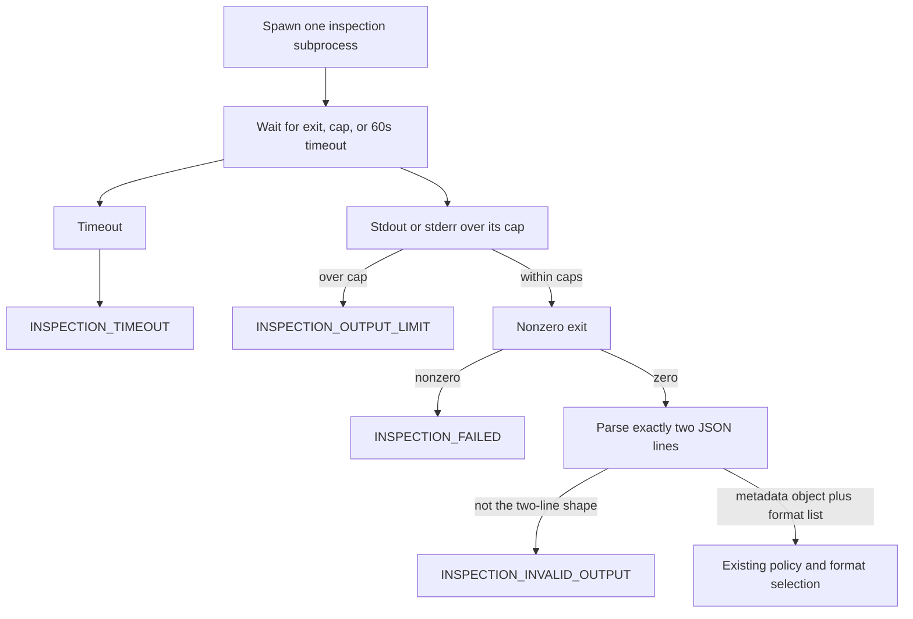

### Report for ORCHESTRATOR_CHAT

Logical whole identity: youtube-fixes
Worker session ordinal: 01
Worker exchange ordinal: 01
Persistent role identity: WORKER
Worker session target: fresh-worker-session
Native planning mode: required
Worker session profile: Planner
Phase: planning
Task identity: PLAN-YOUTUBE-INSPECTION-BOUNDARY-01
status: PARTIAL
Phase-qualified result: not-applicable
Start commit: 2c4f4d89375628df28926060aba305e5d80bacff
End commit: 2c4f4d89375628df28926060aba305e5d80bacff
Report justification: new-evidence
Logical-whole closure: not-closed

Planning cycle: initial
Prior planning report: none
Targeted revision basis: none
Changed decision boundary: none
Preserved unaffected decisions: none
Automatic targeted revisions used: 0

report-write blocked by native Plan Mode. The trace file `/Users/agile/meta/projects/kronika/01/04-youtube_fixes/01_report_00.md` was absent at the gate and was not created. This plan artifact holds the complete report. The heading above this report header is client-plan chrome; a later persistence repair saves the report beginning at `### Report for ORCHESTRATOR_CHAT`.

Repository gate, read-only, matched the prompt: `## main...origin/main`, clean porcelain, `HEAD` `2c4f4d89375628df28926060aba305e5d80bacff`, `.ap` `HEAD` and gitlink `d7023cf037f6d17885c3ede5c04812c61640da50`. `ap doctor` and `ap project check` were not re-run. No network call and no live yt-dlp run.

The PARTIAL status is the missing trace file only. The plan below is frozen and decision-complete. It does not need a targeted revision.

## Decision

Primary route: selective projection through the pinned tool's documented `--print` output template, plus inspection-only early termination, plus separate inspection and download constants at the same numeric values.

Keep `INSPECTION_OUTPUT_LIMIT`, stage `inspection`, companion text `Download failed`, and the operator JSON fields. Do not raise the 1 MiB or 64 KiB numbers. Do not change the yt-dlp pin.

## 1. Diagnosis

`YtDlpYouTubeDownloader.inspect()` in [src/kronika/infrastructure/youtube/downloader.py](src/kronika/infrastructure/youtube/downloader.py) runs `sys.executable -I -m yt_dlp` with `--dump-single-json --skip-download --no-write-info-json` and the canonical URL after `--` (lines 169-175). Caps are `MAX_STDOUT_BYTES = 1_048_576` and `MAX_STDERR_BYTES = 65_536` (lines 55-56). Overflow before `json.loads` raises `YouTubeInspectionError("INSPECTION_OUTPUT_LIMIT")` (lines 186-189). `YouTubeAcquisitionCoordinator._process` maps that to stage `inspection` through `_fail` (lines 1109-1114 and 1418-1438), which stores `FAILED`, the code, `completed_at_ms`, then cleanup. No media is created. The request API copies `failure_category` and `failure_code`. The operator CLI prints them in the status JSON. `youtubeSnapshot()` in [extension/background/service_worker.js](extension/background/service_worker.js) does not copy `failure_code`; phase `failed` becomes companion text `Download failed` from [extension/shared/messages.js](extension/shared/messages.js).

### Field inventory

`_inspection_from_payload` (lines 273-328) reads:

- `extractor_key` must equal `Youtube`, or `UNSUPPORTED_MEDIA`.
- `id` must equal the canonical video id, or `UNSUPPORTED_MEDIA`.
- `_type` must be absent or `video`, or `UNSUPPORTED_MEDIA`.
- `is_live is True`, or `live_status` in `is_live`, `is_upcoming`, `post_live`, `was_live`, or `UNSUPPORTED_MEDIA`.
- `availability` in `needs_auth`, `premium_only`, `subscriber_only`, `private`, `needs_subscription`, or `UNSUPPORTED_MEDIA`.
- `age_limit` boolean, or a number above 0, or `AUTHENTICATED_MEDIA_REQUIRED`.
- `duration` must be a finite number, greater than 0 and at most 21600, or `DURATION_LIMIT`.
- `formats` must be a list, or `NO_VISUAL_STREAM`.
- `title`, `channel`, `channel_id` are advisory and may become null under the existing length normalizer.
- `upload_date` becomes `source_date` only for an 8-digit string, otherwise null.
- `_filename`, else `filename`, becomes advisory `remote_filename`, otherwise null.

`_select_plan` (lines 330-414) reads, per format: `has_drm`, `format_id`, `vcodec`, `acodec`, `video_ext` or `ext`, `audio_ext` or `ext`, `height`, `width`, `fps`, `tbr`, `abr`, `asr`, `filesize`, `filesize_approx`. It skips DRM and unsafe format ids, prefers a size-legal visual-plus-audio pair, then a size-legal combined stream, then a silent visual stream. An expected size above `max_final_size_bytes` (default 1 GiB) is `FINAL_SIZE_LIMIT` or `COMPATIBLE_FORMAT_UNAVAILABLE`. A missing size is allowed and checked again after download.

Persisted from a successful inspection, in `_inspect` (lines 1147-1159): title, channel, channel id, source date, downloader name `yt-dlp`, both version fields, selected format ids, remote filename. Duration and the size estimate are not separate claim columns; they gate the plan. No consumed field is a URL, fragment list, caption, thumbnail, heatmap, chapter, comment, or description.

### Payload composition for yt-dlp 2026.7.4

`poetry.lock` and `pyproject.toml` pin `yt-dlp==2026.7.4`. Installed source, not a live run:

- `--dump-single-json` is quiet and prints one JSON document for the URL (`options.py` lines 1311-1316). On success, `YoutubeDL.__download_wrapper` calls `json.dumps(self.sanitize_info(res))` (`YoutubeDL.py` lines 3699-3701).
- `sanitize_info` without `remove_private_keys` keeps every key (`YoutubeDL.py` lines 3756-3763). The dump therefore includes format URLs, fragment lists, captions, and storyboards.
- Comments are off unless requested. `--write-comments` / `getcomments` defaults false (`options.py` line 1526). Inspection does not pass it.
- Heatmap markers are a short list. Tests in the extractor expect `count:100` (`_video.py` `_extract_heatmap`, lines 2357-2365).
- Storyboards are formats with a materialized `fragments` list (`_video.py` lines 3787-3790). `_select_plan` does not read `fragments` or `url`.
- The size mechanism that can pass 1 MiB on a public video is automatic captions. `_SUBTITLE_FORMATS` has seven extensions (`_video.py` line 141). `get_translated_subs` is true only for `--write-auto-subs` or subtitle listing (lines 4224-4225). Inspection sets neither, so manual-subtitle translation is skipped. For an automatic track the skip sits inside `if is_manual_subs` (lines 4280-4286), and `process_language` still runs for every `translationLanguages` entry (lines 4298-4300), seven URL objects each. Those objects are assigned to `automatic_captions` (line 4330) and dumped. Kronika never reads that key.

So a legitimate public video can exceed 1 MiB because the dump contains caption and format bulk the selector does not use. This plan does not claim a measured size for the Cooperator's video. The private URL was not opened.

### Stream, shared constants, bound, precedence, tests

Current code uses one code for either overflow and drops both flags (lines 188-189). A successful exit with a huge stderr is possible but unlikely: the argv already passes `--quiet` and `--no-warnings`, and a tool failure is nonzero, which today is reported first as `INSPECTION_FAILED`. The observed code therefore means exit 0 and at least one stream over its cap. The smallest payload-free diagnostic would record only which flag tripped and that the retained length exceeded the cap, then kill the child. That probe is not part of this whole. Projection removes the known bulk sections whichever of those sections was large, and early stop does not need the true byte count.

`MAX_STDOUT_BYTES` and `MAX_STDERR_BYTES` are also the download caps (`_run_download`, lines 429-433; `DOWNLOAD_OUTPUT_LIMIT` at lines 257-260). Raising them would let a download that today dies between the old and new cap continue into artifact checks. Inspection gets its own names at the same numbers. Download keeps the existing names, values, and read-to-EOF behavior.

`_capture_stream` (lines 631-646) retains `limit` bytes and keeps reading until EOF. `_run_bounded` waits until exit or the 60-second inspection timeout, then kills the process group. The cap is a retained-memory bound. The timeout is the time bound. A fast writer can still make the parent read for up to 60 seconds. Early termination is required to make the inspection cap an I/O bound as well. The 60-second timeout remains the bound for a slow stream that never crosses the cap.

Precedence today is nonzero exit, then overflow, then parse (lines 186-193). After early kill, an overflowed child is nonzero by construction, so the old order would label every killed overflow `INSPECTION_FAILED`. The plan reverses that order on the inspection path only.

No test under `tests/` names `INSPECTION_OUTPUT_LIMIT`, `INSPECTION_FAILED`, `INSPECTION_INVALID_OUTPUT`, or `INSPECTION_TIMEOUT`. [tests/unit/infrastructure/youtube/test_downloader.py](tests/unit/infrastructure/youtube/test_downloader.py) pins argv isolation, policy rejections, download resume, attestation timeout, and staging. Its fake returns one JSON object. [tests/integration/test_youtube_acquisition_lifecycle.py](tests/integration/test_youtube_acquisition_lifecycle.py) injects download failure, not inspection failure. Contract tests pass `failure_code` through. Companion tests already map phase `failed` to `Download failed` (`tests/companion_review_extension.test.js`). Those files stay untouched.

## 2. Route comparison

- Route 1, larger retained cap. Rejected. The caption expansion is structural and not a measured size. A larger cap would have to sit high enough for the largest legitimate dump, which widens the memory held in the Kronika process, and a blanket edit would also move `DOWNLOAD_OUTPUT_LIMIT`.
- Route 2, selective projection. Selected. Pinned `yt-dlp==2026.7.4` documents `--print` and the template forms `%(.{id,title})j` and `%(formats.:.{format_id,height})j` in the installed `README.txt` (output-template section, object traversal). `--print` implies quiet and simulate (`options.py` lines 1260-1266). Two ordered `--print` values are appended (`when_prefix`, `append: True`). The child still builds its own info dict; Kronika retains only the projected lines, then applies the same 1 MiB cap.
- Route 3, streaming parse of the full document. Rejected. `json.dumps` of the full dict still happens inside yt-dlp before any byte reaches Kronika. Required format fields are not guaranteed to appear before caption bulk. Chunk, truncation, and duplicate-key handling would be a new parser over untrusted output.
- Route 4, two-stage inspection. Rejected. A second subprocess still needs the same projection to stay small, and it doubles network work and timeout surface. One projected invocation already carries policy fields and format fields.
- Route 5, truthful unsupported outcome as the primary result. Rejected as the primary route. The consumer does not need the sections that make the dump large, so calling the video unsupported would hide a supported selection. Route 5 remains the terminal outcome when the projected document itself exceeds the cap.

Early termination and separate constants are part of route 2, not extra product routes. Projection decides what is emitted. Early stop decides that inspection does not read past the cap. Separate constants keep download behavior fixed.

## 3. Proposed behavior

Production constants:

- `INSPECTION_STDOUT_LIMIT_BYTES = 1_048_576`
- `INSPECTION_STDERR_LIMIT_BYTES = 65_536`
- `MAX_STDOUT_BYTES` and `MAX_STDERR_BYTES` stay `1_048_576` and `65_536` and are used only by download.

Inspection argv, one list, no shell, after the existing common flags `--ignore-config --no-playlist --no-warnings --quiet --no-cache-dir` and the existing socket and retry flags:

- add `--simulate`
- keep `--no-write-info-json`
- remove `--dump-single-json` and `--skip-download`
- `--print` plus the metadata template
- `--print` plus the formats template
- `--` and the canonical URL

Metadata template, one argument:

`%(.{extractor_key,id,_type,is_live,live_status,availability,age_limit,duration,title,channel,channel_id,upload_date,_filename,filename})j`

Formats template, one argument:

`%(formats.:.{format_id,ext,video_ext,audio_ext,vcodec,acodec,height,width,fps,tbr,abr,asr,filesize,filesize_approx,has_drm})j`

`--dump-single-json` must not remain. Its wrapper writes the full document after extraction (`YoutubeDL.py` lines 3699-3701). `--skip-download` must not replace `--simulate`: simulate returns before description, subtitle, thumbnail, and info-json writes (`YoutubeDL.py` lines 3376-3379). Explicit `--simulate` stays even though `--print` implies it.

Parser, inspection only:

- UTF-8 strict. Failure is `INSPECTION_INVALID_OUTPUT`.
- Exactly two non-empty lines. Line 1 is one JSON object and must not contain `formats`. Line 2 is one JSON list. Any other shape, including one full info JSON object, `NA`, or extra lines, is `INSPECTION_INVALID_OUTPUT`.
- Set `formats` from line 2 and call the existing `_inspection_from_payload`. Do not log either line.

Overflow handling, inspection only:

- `_capture_stream` gains `stop_after_limit=False`. Inspection passes true. On the first overflowing chunk it retains at most the cap and returns. It does not read further and does not count discarded bytes.
- `_run_bounded` gains `terminate_on_overflow=False`. Inspection passes true. On overflow, cancel the other capture, best-effort the existing process-group TERM/KILL helper, swallow termination errors the same way the timeout path does, and return the overflow flags.
- `inspect` checks overflow before return code. Termination failure must not be relabeled `INSPECTION_TIMEOUT`.
- Download and version attestation keep today's read-to-EOF capture and do not pass the new flags.

End state, all inspection failures persist stage `inspection` and the code below. `status` prints one JSON line with those fields and exits 0. `ingest` and `status --wait` print the same JSON and then raise the existing `YouTube acquisition failed.` Companion phase `failed` stays `Download failed` for every code below. No new copy.

- Stdout length equal to the cap, exit 0, valid two-line JSON: inspection succeeds and uses the existing selector.
- Stdout one byte over the cap, stderr inside its cap: `INSPECTION_OUTPUT_LIMIT`, no parse, process group terminated.
- Stdout far over the cap: same code, retained stdout no larger than the cap, child terminated without reading the rest.
- Stdout overflow only, stderr overflow only, or both: `INSPECTION_OUTPUT_LIMIT`.
- Nonzero exit and overflow: `INSPECTION_OUTPUT_LIMIT`.
- Nonzero exit, neither stream over cap: `INSPECTION_FAILED`.
- Timeout before a cap: `INSPECTION_TIMEOUT`, existing TERM then KILL.
- Exit 0, under the cap, truncated or non-JSON text, an empty stdout, or a single JSON object: `INSPECTION_INVALID_OUTPUT`.
- Valid projection that fails an existing policy or size rule: the existing code (`UNSUPPORTED_MEDIA`, `AUTHENTICATED_MEDIA_REQUIRED`, `DURATION_LIMIT`, `NO_VISUAL_STREAM`, `COMPATIBLE_FORMAT_UNAVAILABLE`, `FINAL_SIZE_LIMIT`).
- Download stdout or stderr over the download caps: still `DOWNLOAD_OUTPUT_LIMIT` after the process exits. The download child is not killed for output overflow.

## 4. Implementation boundary

Changed paths:

- [src/kronika/infrastructure/youtube/downloader.py](src/kronika/infrastructure/youtube/downloader.py): constants, `inspect` argv and precedence, projection parser, `_capture_stream` flag, `_run_bounded` flag. `_select_plan`, `_inspection_from_payload` policy, download argv, and `_run_download` stay.
- [tests/unit/infrastructure/youtube/test_downloader.py](tests/unit/infrastructure/youtube/test_downloader.py): two-line stdout for existing inspection fakes; exact argv assertion; the matrix below; download non-regression.
- [tests/integration/test_youtube_acquisition_lifecycle.py](tests/integration/test_youtube_acquisition_lifecycle.py): `_FakeDownloader.fail_inspection` and one terminal-cleanup test.
- [SPEC.md](SPEC.md): one sentence in the owner-operated YouTube paragraph (around lines 776-786).

Symbols: `INSPECTION_STDOUT_LIMIT_BYTES`, `INSPECTION_STDERR_LIMIT_BYTES`, `INSPECTION_METADATA_TEMPLATE`, `INSPECTION_FORMATS_TEMPLATE`, `_projected_inspection_document`, `inspect`, `_capture_stream`, `_run_bounded`.

Untouched: `extension/`, X acquisition, `youtube_acquisition.py` production code, domain, request API, operator CLI, schema and migrations, `deploy/`, `pyproject.toml`, `poetry.lock`, `configuration.py`, README, every ADR, `docs/X_COMPANION.md`, companion tests. The coordinator already stores `exc.code` and cleans up.

Tests, all synthetic, no network. Implement as parametrized cases where the expected code is the only difference:

- at-cap valid two-line JSON succeeds
- one byte over, far over, stdout only, stderr only, both streams: `INSPECTION_OUTPUT_LIMIT`
- far over also asserts retained length and `SIGTERM`/`SIGKILL`, reusing the kill pattern in `test_timeout_terminates_process_group_then_uses_bounded_kill_fallback`
- nonzero plus overflow: `INSPECTION_OUTPUT_LIMIT`
- nonzero without overflow: `INSPECTION_FAILED`
- hanging child: `INSPECTION_TIMEOUT`
- partial JSON, invalid JSON, empty stdout, one full JSON object: `INSPECTION_INVALID_OUTPUT`
- download overflow still waits and raises `DOWNLOAD_OUTPUT_LIMIT` without `killpg`
- equivalence fixture below

Integration: fake `inspect` raises `YouTubeInspectionError("INSPECTION_OUTPUT_LIMIT")`. After drain, the claim is `FAILED`, stage `inspection`, that code, cleanup `complete`, staging gone, `download_calls` empty. Retry behavior is already pinned by the download-failure test and is not changed.

Later implementation validation, not this grant:

`./.ap/ap exec --root /Users/agile/Projects/kronika --baseline <authorized-sha> --operation test-focus -- tests/unit/infrastructure/youtube/test_downloader.py tests/integration/test_youtube_acquisition_lifecycle.py -q -p no:cacheprovider`

Contract, CLI, and companion suites are not required for this allowlist.

## 5. Format-selection equivalence

One fixture builds a full info dict containing split visual and audio streams, a higher-height stream later in the list, a combined stream, a DRM stream that would otherwise win, an over-cap pair, format `url` and `fragments`, and top-level captions, heatmap, description, and thumbnails. Compare `YouTubeDownloadPlan` from `_inspection_from_payload` on that full dict with `inspect` on the two-line projection of the same allowlist. They match for the split-stream winner, the combined-stream winner when the split pair is over the final-size cap, the silent-visual fallback, and `FINAL_SIZE_LIMIT` when every legal candidate is over the cap. Advisory title, channel, channel id, source date, and remote filename match when those keys are present. Extra keys are absent from the projected stdout and cannot change the plan.

## 6. Security argument

The child is still `create_subprocess_exec` with `start_new_session`, `stdin` devnull, the existing five-variable environment, `--ignore-config`, and no cookie argument. One inspection subprocess at a time is unchanged. Staging is untouched at inspection. Nothing from stdout or stderr is logged; the exception text stays `YouTube downloader operation failed.`

Memory: each inspection capture retains at most its cap. Early return drops the rest of the overflowing chunk instead of storing it. Download memory behavior is unchanged.

I/O: inspection stops reading at the cap and kills the group. A stream that stays under the cap is still bounded by 60 seconds and the existing TERM/KILL helper. The new flags are default-off, so attestation and download do not gain a kill-on-output path.

The projection template is a source constant, not data from the URL. The URL remains a separate argument after `--`. The error code does not include a byte count, stream name, URL, title, or payload, so the early-stop path is not a new information channel. A hostile child that emits only junk under the cap still ends in `INSPECTION_INVALID_OUTPUT` or an existing policy code.

## 7. Pinned-tool argument

The mechanism is the documented output template and repeated `--print`, implemented by `prepare_outtmpl` / `traverse_obj` and `_forceprint` in this pin. `formats.:.{...}` is list-order-preserving field projection, not a private extractor object. The plan depends on those documented names and on the two-line stdout shape. It does not depend on caption layout, fragment layout, or key order inside the full dump.

A future pin can change template syntax or print an extra line. The strict parser then fails closed with `INSPECTION_INVALID_OUTPUT`, and the argv test fails. Repair is a separate pin decision under ADR-0061 and ADR-0064: ADR-0064 records an intentional maintenance gate on every future yt-dlp pin change. That decision is D3. This plan does not change `2026.7.4`.

## 8. Failure and quota

If the projected document or stderr still exceeds its cap, the claim is terminal `FAILED`, stage `inspection`, code `INSPECTION_OUTPUT_LIMIT`, staging cleaned, no media. The same mapping already exists. No product retry rule changes. Any `FAILED` claim can be retried through `YouTubeRequestService.retry`, which creates a new claim. `count_failed_transitions_since` counts `FAILED` rows with `completed_at_ms` in the window, and the default ceiling is `DEFAULT_YOUTUBE_REQUEST_MAX_FAILED_PER_24H = 10`.

Live reproduction, if later authorized, is one new claim and zero retries. That is operational guidance. It does not need a code change.

## 9. Documentation owner

Smallest durable owner is one SPEC sentence in the existing YouTube ingestion paragraph: inspection requests only the metadata and format-selection fields the server consumes, retains at most 1 MiB of inspection standard output and 64 KiB of inspection standard error, terminates that inspection subprocess when either cap is exceeded, and a larger document fails closed as `INSPECTION_OUTPUT_LIMIT` without being parsed or logged.

Do not rewrite ADR-0046, ADR-0054, ADR-0086, or ADR-0089 through ADR-0092. Do not add an ADR. The 2026-07-23 decision text does not mention this cap and stays historical. README does not claim the old dump shape, so it stays unchanged.

## 10. Acceptance

Automated, implementation worker, no network:

1. Projection argv contains `--simulate`, both templates, `--no-write-info-json`, and no `--dump-single-json`, `--skip-download`, or cookie flag.
2. The end-state matrix in section 3 passes, including early kill and the download non-regression.
3. The equivalence fixture matches on split, combined, and final-size outcomes.
4. The integration claim is terminal, cleaned, and has no download and no media.

Operator CLI, only if a failed claim is inspected under a later grant: status JSON `failure_stage` `inspection` and `failure_code` `INSPECTION_OUTPUT_LIMIT` or the other inspection code. No new sentence.

Rendered, Cooperator, only after publication and the routine NUC refresh: one save of the previously failing video. Success is the existing saved or saved-privately companion state. A remaining cap or policy failure is `Download failed`. Extension reload is not required; no extension file changes.

Routine release, later grant only, sole entry `deploy/ubuntu/kronika-release`: `status`, then `check --release <40-hex-SHA>`, then an explicit deploy authority, then `deploy --release <SHA> --yes`. Check does not deploy.

## 11. Risks and stop conditions

Stop the implementation if the equivalence fixture diverges, if download lifetime or `DOWNLOAD_OUTPUT_LIMIT` changes, if the numeric caps would have to rise, if stdout would be logged, or if the two-line shape cannot be produced by this pin without a pin change. Do not add a network test to prove the template. Static source evidence and fake-process tests are the implementation proof.

Residual risks:

- The specific video can remain unacquirable if the projected document or stderr still exceeds the cap, or if an existing policy check rejects it. That is an honest `INSPECTION_OUTPUT_LIMIT` or the existing policy code, not a successful acquisition.
- A future pin can break the template. The parser fails closed.
- yt-dlp's own process can still allocate a large info dict. The Kronika retain bound does not cap the child's RSS. That is the existing subprocess tradeoff, not a new unbounded buffer in the parent.
- One live attempt consumes one of the ten daily failed-claim slots if it fails. The attempt cap is one, with no retry.

Security regression would be a larger parent buffer, reading past the cap, logging output, or a cookie or shell flag. Product lie would be reporting success, or a new companion sentence, for a video that was not acquired.

## 12. Cooperator decisions

Recommendations only:

- D1. Accept route 2 with inspection-only early termination and unchanged numeric caps.
- D2. Accept this plan on synthetic evidence. Authorize at most one live attempt after implementation, capturing only stage, code, tool version, and whether a media id exists.
- D3. Do not change the yt-dlp pin.
- D4. Do not take R-2 or R-3 into this whole.
- D5. Do not change operator prose or companion status.
- D6. Publish and refresh the NUC only under a later grant, using the sequence in section 10.
- D7. If that single live attempt still ends in `INSPECTION_OUTPUT_LIMIT` or an existing policy code, accept that this video stays unacquirable inside the bound.

## 13. Decision-complete statement

An implementation worker can execute sections 3 through 5 and 9 without another planning choice. The plan is false if the equivalence fixture cannot match, if this pin cannot emit the two documented lines for one video, or if a projected document of only the consumed fields still cannot fit in 1 MiB for ordinary format lists. The last case stays `INSPECTION_OUTPUT_LIMIT` and returns the outcome to D7. It does not authorize a larger cap inside this whole.

Changed files: none in the repository. The report file was not written.
Validation: read-only git identity, `downloader.py`, acquisition mapping, domain failure-code pattern, CLI status writer, companion snapshot, the unit and integration tests named above, `SPEC.md` YouTube paragraph, ADR-0046, ADR-0064 pin gate, configuration default 10, and the installed yt-dlp `options.py`, `YoutubeDL.py`, `extractor/youtube/_video.py`, and `README.txt`. No test, Python, or network command was run.
Git result: no fetch, stage, commit, or push.
Deviations: report-write blocked by native Plan Mode. Live payload size is unmeasured by design. `ap doctor` was not repeated.
Smallest next step: persist this report with Planner-Artifact Report Completion Repair. Do not re-plan and do not implement.
Authority expiry: this report ends the planning grant. Plan approval is not implementation authority. Implementation needs a new Orchestrator prompt with `Native planning mode: not-used`, the exact baseline, the allowlist, and explicit boundaries.

Orchestration critique:
MEASURED: full `--dump-single-json` emits caption and storyboard bulk that `_inspection_from_payload` and `_select_plan` do not read; evidence is yt-dlp 2026.7.4 `_video.py` lines 141, 4224-4300, 4330, and 3787-3790 against `downloader.py` lines 273-414; effect is that projection keeps the 1 MiB cap truthful; smallest correction is none in this exchange.
LEAD: the Cooperator's video could still overflow after projection, or the original overflow could have been stderr on a zero exit; cheapest check is one later authorized attempt that records only stage, code, and whether media was created.
Resolved Execution Issues / Near-Misses: report-write blocked by native Plan Mode; cause is the client's write restriction; resolution is the complete report in this plan artifact; residual risk is that `01_report_00.md` is still absent until the repair grant.
Pre-Existing Failure Classification: none
